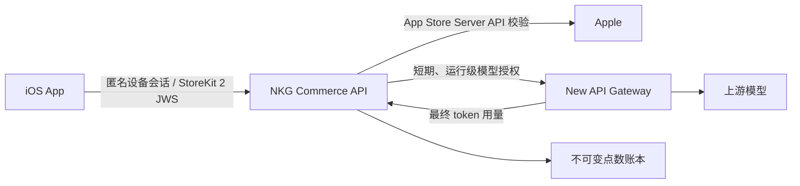

# NKG 托管 AI 点数架构

状态：客户端协议、StoreKit 2 原生桥接、Commerce API、PostgreSQL 账本、Apple JWS 验证和 New API 反向代理均已实现。尚需在 App Store Connect 创建商品、部署生产环境并完成 Sandbox 真机验收。

## 产品边界

- App 免费下载。
- 自定义工作流、内置能力和 BYOK（连接用户自己的模型）免费使用。
- 只有用户主动选择 **NKG AI** 托管模型服务时才消耗 AI 点数。
- 购买点数永久有效；赠送点数可以有单独的活动规则，但必须向用户明确展示。
- token 用量按每次模型调用计算并向上取整；非零用量最低扣 1 点，客户端必须在购买页展示该规则。
- App 内不使用“中转”作为产品定位。对用户统一称为“NKG AI”或“NKG 托管模型服务”。

## 信任边界



客户端永远不能获得 New API 管理员密钥或长期共享令牌。客户端仅保存 NKG 账户会话令牌，并在每次运行前申请短期、运行级授权。

New API 负责模型路由和用量采集，但不是购买记录和点数余额的最终来源。购买、赠送、预留、结算和退款必须记录在 NKG 自己的服务端账本中。

## 客户端服务协议

服务根地址默认为 `https://api.lfzxb.top`。当前客户端通过以下构建变量选择性启用：

```text
VITE_NKG_HOSTED_AI_ENABLED=true
VITE_NKG_HOSTED_AI_SERVICE_URL=https://api.lfzxb.top
```

在生产服务端路由可用之前不得开启正式构建中的功能开关。

### `POST /api/app/v1/sessions/anonymous`

请求：

```json
{
  "installationId": "UUID",
  "platform": "ios",
  "appVersion": "1.0.0"
}
```

响应包含匿名账户、短期会话令牌、服务端余额和可用模型目录。`installationId` 只用于恢复本机匿名账户，不应作为防刷或身份认证的唯一依据。

### `GET /api/app/v1/account`

使用 NKG 会话令牌读取最新余额和模型目录。客户端可以展示响应，但不得把本地缓存当作可消费余额。

### 点数账户恢复

新匿名账户同时获得一个 256-bit 随机恢复码；客户端将其放入本机安全存储，服务端只保存 SHA-256 哈希。用户可在点数页显示并离线保存恢复码：

- `POST /api/app/v1/sessions/recover` 在重装或换设备后重新绑定原点数账户。
- `POST /api/app/v1/account/recovery/rotate` 在已登录状态下生成新恢复码并立即废止旧码。
- 恢复码等同账户密码，不能写入日志、分析事件、SQLite 或普通偏好设置。

消耗型内购不会由 App Store 自动恢复，因此“购买点数永久有效”的承诺必须由服务端账户账本和此恢复机制兑现。

### `POST /api/app/v1/runs/authorize`

请求携带 `requestId`、`flowId` 和 `modelId`，并使用 `requestId` 作为 `Idempotency-Key`。服务端必须：

1. 校验账户、模型和余额。
2. 创建运行记录并按策略预留点数。
3. 返回只允许该次运行、短时间有效的模型网关凭据。
4. 同一工作流运行可包含多次模型调用；每次调用独立结算，累计扣点不得超过本次运行预留。
5. 收到 token 用量后按模型倍率结算；上游已接受但未返回可信用量时，按剩余预留失败封顶。
6. 对从未到达上游的超时运行释放预留；交易和每个网关请求都必须幂等。

单个工作流最多接受 64 次模型请求，同时在途请求最多 4 个，用于限制同一预授权在结算前被并发放大的上游成本。

授权先按默认模型建立预留。工作流内某个节点选择其他服务端目录模型时，网关会在访问上游前原子地把运行预留提升到该模型的策略上限；余额不足则直接拒绝该节点。每个请求保存自己的 `model_id` 并使用对应费率结算，因此多模型工作流不会被静默改成默认模型。

Runtime 在工作流成功、失败或取消后的 `finally` 中调用 `POST /api/app/v1/runs/complete`。服务端立即释放未用预留；如果存在“上游已接受但尚未结算”的请求，则先按剩余预留失败封顶，再关闭授权。客户端崩溃时由过期清算执行同样规则。

余额不足使用稳定错误码 `insufficient_points`，客户端据此引导用户购买点数或切换自己的模型。

### `POST /api/app/v1/purchases/apple`

客户端上传 StoreKit 2 的 `signedTransactionInfo` 和稳定的 `appAccountToken`。客户端提供的幂等键只用于重试去重，服务端必须自行执行：

1. 通过 Apple 官方链路验证 JWS 签名和证书链。
2. 校验 bundle ID、environment、product ID、transaction ID、撤销状态与交易归属。
3. 以 Apple `transactionId` 建立唯一约束；同一交易只能入账一次。
4. 按服务端商品表决定点数，不信任客户端提交的数量或价格。
5. 在一个数据库事务内写入购买记录、点数账本和新余额。
6. 处理退款、撤销和 App Store Server Notifications V2，写入相反账本分录，不修改历史分录。

## 点数账本

推荐使用追加式账本。核心表至少包括：

- `accounts`：匿名账户、后续登录绑定关系和状态。
- `installations`：安装标识与账户绑定；敏感信号单独加密或哈希。
- `apple_transactions`：Apple 原始交易标识、商品、环境、验证状态和唯一约束。
- `point_ledger`：追加式 `purchase`、`grant`、`usage`、`refund`、`adjustment` 分录。
- `model_runs`：工作流运行、模型、预留上限、累计 token、累计扣点和结算状态。
- `gateway_requests`：运行内每次上游调用、上游接受时间、用量和独立结算状态。
- 模型目录与点数倍率由服务端环境配置发布，客户端不能覆盖计费字段。

余额应由账本汇总或由同一事务维护的快照得出。任何管理员调整都要产生带操作者和原因的账本分录。

## StoreKit 2 客户端交付规则

客户端使用一个独立的 Tauri iOS 原生插件调用 StoreKit 2：

- 商品 ID 只能来自服务端账户响应中的 `pointPacks`，名称和价格只使用 App Store 本地化返回值。
- 购买时将服务端签发的 UUID 作为 `appAccountToken` 传给 StoreKit。
- 购买成功后先把交易 JWS 交给 NKG Commerce API；只有服务端确认入账后才调用 `Transaction.finish()`。
- 每次启动均处理 `Transaction.unfinished`，运行期间监听 `Transaction.updates`。断网、崩溃或服务端失败时不 finish，后续自动重试。
- 客户端仅处理商品 ID 与 `appAccountToken` 都匹配当前 NKG 账户的交易；服务端仍须独立验证全部字段。

## 上线前门禁

- 在 App Store Connect 创建消耗型点数商品，并使用 StoreKit Configuration 与 Sandbox 完成真机测试。
- 部署 Commerce API、数据库迁移、Apple 验证、Server Notifications V2 与专用 New API 受限令牌。
- 完成并发授权、重复通知、退款、超时释放、余额不足、断流封顶和服务重启恢复的集成测试。
- 在 App Store Connect 隐私信息、内购说明、未完成交易自动恢复机制和审核备注中如实说明；消耗型点数不展示误导性的“恢复购买”按钮。
