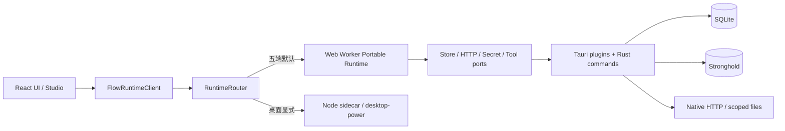

# 跨平台 Runtime 实施审查报告（2026-07-20）

> 最新复核：2026-07-21。以下数据和入口语义已按默认 portable Runtime 更新。

## 结论

当前项目结构已经从“桌面 sidecar + 移动特例”调整为合理的五端本地优先架构：

- 五端默认执行同一套 `portable` TypeScript Runtime；
- Node sidecar 仅是桌面显式 `desktop-power` 兼容模式；
- 业务数据、Flow、Run、事件、artifact 和变量均保存在用户设备；
- Provider URL 与 API Key 由用户配置，API Key 使用 Stronghold，本项目没有云端存储；
- Portable Runtime 在独立 Web Worker 中执行；Tauri/Rust 只实现 SQLite、密钥、原生 HTTP、受控文件等宿主能力；
- nkg-ai-flow 保持 Tauri 无关，并通过公开 package exports 提供 portable 能力。
- `@ai-native-flow/runtime` 包根即 portable 默认入口，业务层不再感知 `/browser`；
  Node 文件与进程能力只从显式 `/node` 入口进入。

该结构适合继续做聊天、自定义提示词角色和 Flow 编排助理。当前主要风险已经不是
“移动端没有 Node.js”或 UI 线程执行 Flow，而是物理真机、macOS 签名安装包、
长 Flow 压测和高权限工具授权尚未完成。

## 当前组件边界

| 模块 | 应承担的职责 | 审查结果 |
|---|---|---|
| `nkg-ai-flow` | Flow IR、节点、调度、事件、capability、portable ports | 合理；未绑定 Tauri |
| `runtime-router` | backend 选择和统一客户端协议 | 合理；模式与平台已解耦 |
| `tauri-runtime-adapter` | 将 Tauri 能力映射为 nkg ports | 合理；已移除源码深路径导入 |
| `apps/client/src-tauri` | SQLite、Stronghold、sidecar 和原生工具命令 | 合理；桌面依赖按 target 条件编译 |
| `runtime-sidecar` | desktop-power 兼容执行 | 合理；不再是默认核心依赖 |
| React UI | 产品交互、目录同步、生命周期与 capability 预检 | 合理；高权限写工具仍保持关闭 |

## Android 200+ MiB 的审查结论

历史 200+ MiB 包是 Debug 产物，不是当前发布结构的固有成本。Debug 包同时包含大量
符号、未裁剪 Rust 代码、未压缩资源和调试 ABI，因此不能用于评估上架体积。

当前 arm64 实测：

| 产物 | 体积 | 用途 |
|---|---:|---|
| Debug APK | 241.12 MiB | 开发调试，不发布 |
| Release APK | 约 14.40 MiB | 默认本地分发/安装基线 |
| Release AAB | 8.23 MiB | 可选 Google Play 上传基线，不在默认 Release 中生成 |

Release 已启用 Rust symbol strip、Thin LTO、`panic=abort`、R8 和资源裁剪；本地发布脚本对 APK
执行 40 MiB 硬门禁。受控 ToolHost、SQLite persistence 和 portable Runtime 接入后，
体积仍稳定在约 14.40 MiB，证明这些架构修正没有重新引入桌面 sidecar 依赖。

## 已验证事实

| 维度 | 当前证据 |
|---|---|
| nkg-ai-flow | 52 个测试文件、757 项测试通过，TypeScript typecheck 与包根 browser bundle Node builtin 门禁通过 |
| 主项目 | 35 个测试文件、137 项测试通过，TypeScript typecheck 通过 |
| Rust | 默认 portable migration/路径 scope 3 项通过；desktop-power 保留独立 feature 门禁 |
| 前端 | 主线程 runtime 约 101 KiB，Worker 约 583 KiB，AI SDK provider 约 281 KiB 按需加载，构建体积预算通过 |
| Android | arm64 Release APK 约 14.40 MiB；Android 16 Emulator 流式聊天与 HOME/恢复 E2E 通过 |
| iOS | 历史 arm64 Simulator Release 门禁通过；App Store IPA 等待真实 Mac 签名验收 |
| 桌面 | Windows 默认 portable NSIS 约 4.13 MiB，并完成安装、启动 8 秒、卸载 smoke；macOS 等待真实签名机 |
| 包边界 | 顶层干净 `npm ci`、公开 `@ai-native-flow/*` 导入和禁止深路径门禁通过 |
| 自带 Flow | 3/3 结构与 3/3 确定性执行通过；portable/desktop-power 分类明确 |

这些证据证明代码边界与 Release 构建可用，但不等同于五端真机产品验收。

## 稳定性与安全审查

已经处理：

- Runtime Store 使用 SQLite 持久化，不再依赖生产内存状态；
- checkpoint 写入先于对应事件发布，降低崩溃后状态倒挂风险；
- 请求级变量覆盖与持久化变量分层，API Key 不进入普通 Runtime 变量表；
- capability 在 Flow 注册和执行解析前检查，拒绝运行到一半才发现宿主缺失；
- portable 与 Node 工厂均自动提供默认 capability manifest，业务层不必重复注入基础清单；
- ToolHost 在 TypeScript 与 Rust 两侧重复校验 allow-list；
- 原生文件路径固定在应用私有目录，拒绝绝对路径、父目录和 symlink escape；
- 移动端不暴露 `filesystem.write` 或 `process.spawn`；
- HTTP/LLM 使用显式客户端注入，不污染全局 fetch；
- sidecar 崩溃后不自动重放可能产生副作用的请求。
- Worker 原生 fetch 按 chunk 转发并传播取消，SSE 不会退化为整包缓冲；
- Run/Event 默认执行 30 天、500 Run、25 MiB 配额清理，活动 Run 不删除；
- migration SQL 强制 LF，Windows/macOS 构建产生一致的 SQLx checksum。

仍需处理：

| 优先级 | 缺口 | 风险/影响 | 建议验收 |
|---|---|---|---|
| P1 | macOS DMG/IPA 等待真实发布机签名与启动验收 | Windows 通过不代表 WebKit/签名链可用 | 在真实 Mac 执行完整 Release |
| P1 | Android/iOS 真机矩阵不足 | WebView、网络、挂起和密钥行为可能不同 | 同 Flow 真机 contract |
| P2 | Worker 已隔离 UI，但尚无大图/CPU 节点响应性基准 | 线程隔离不代表内存和调度预算合理 | 长 Flow、取消延迟与内存压测 |
| P2 | 写文件与用户目录授权未实现 | 助理能力受限，但贸然开放会扩大攻击面 | 选择目录 + 预览 + 逐次确认 |
| P3 | Worker 核心约 583 KiB | UI 首屏已隔离，但 Worker 首次启动仍有解析成本 | 继续拆分低频节点 pack |

## 下一轮优化顺序

1. 在真实 Android/iOS 设备运行同一 fixture、流式取消和前后台恢复 gate；
2. 在真实 Mac 完成 DMG/IPA 签名、安装和启动 smoke；
3. 为长 Flow 增加 Worker CPU、内存与取消延迟基准；
4. 继续把低频节点拆为按需 pack；
5. 在明确用户确认流程后，再增加用户选择目录和写工具。

## 审查判定

- 结构合理性：**通过，允许继续产品开发**。
- Android 发布体积：**通过，200+ MiB 问题已被 Release 基线消除**。
- 五端语义一致性：**代码、Windows 安装包与 Android Emulator 门禁通过；Android/iOS
  物理真机和 macOS 签名安装包仍需补齐**。
- nkg-ai-flow 自带 Flow 通过率：**结构 3/3、确定性执行 3/3；两个高权限 Flow 已正确
  分类为 desktop-power**。
- 完全下沉跨平台能力到 submodule：**本轮目标完成**。核心执行组合（默认 portable
  runtime、显式 Node runtime、capability、HTTP/fetch 注入及 `createPortableHttpRuntime`）和公共
  persistence/ToolHost ports 均由 nkg-ai-flow 提供；Tauri 实现按端留在主项目，
  Worker/lifecycle、流式原生 fetch、capability UI 与 Run retention 也已完成；后续重点是
  真实设备发布验收和性能基准。
