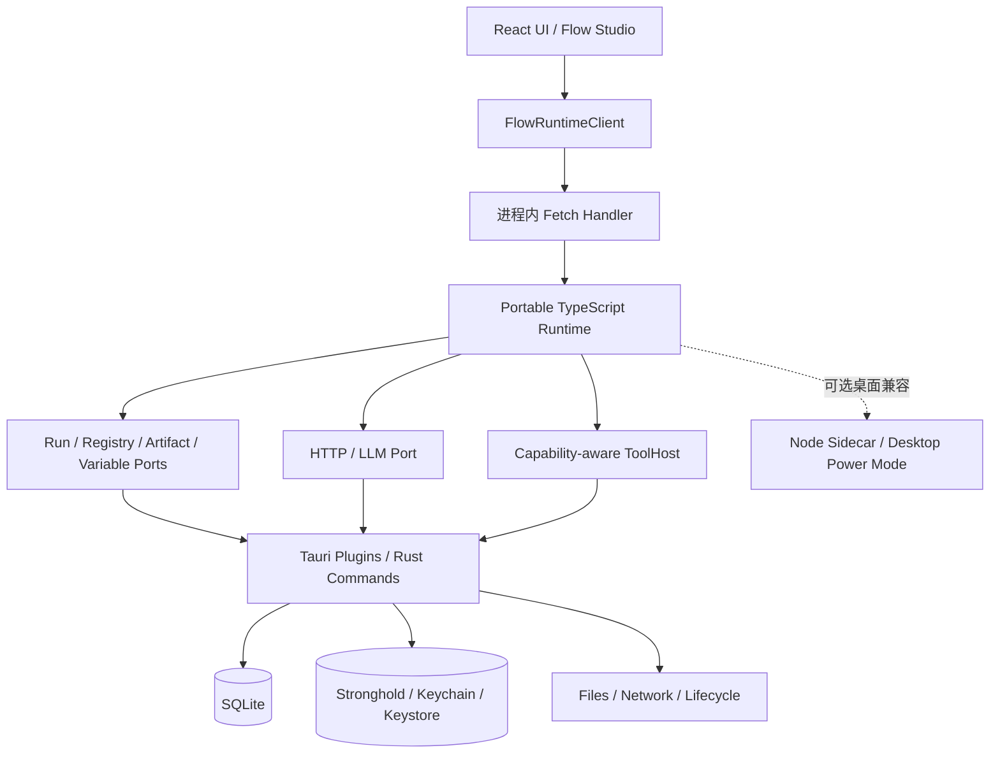

# nkg-ai-flow / nkg-ai-bot 跨平台 Runtime 去 Node 化改造指南

> 文档定位：供后续 AI Agent 和开发者直接执行的架构决策、实施路线与验收清单。
> 编写日期：2026-07-20
> 适用仓库：`nkg-ai-bot` 及其 Git submodule `nkg-ai-flow`
> 相关文档：[`runtime-routing.md`](./runtime-routing.md)、
> [`implementation-audit-2026-07-20.md`](./implementation-audit-2026-07-20.md)

## 1. 执行摘要

当前跨平台问题的根因不是 TypeScript，也不是 Flow 节点画布，而是部分
Runtime、节点和工具直接依赖 Node.js 提供的宿主能力，例如 `node:fs`、
`node:http`、`node:child_process`、`process.env` 和动态 Node Pack 加载。
Android/iOS 的 Tauri WebView 可以运行 JavaScript，但默认没有 Node.js Runtime，
所以这些 Node 专属实现不能原样进入移动端。

本项目的推荐方向如下：

1. **不全量使用 Rust 重写 nkg-ai-flow。**
2. **保留 TypeScript 实现的 Flow IR、校验、调度、事件语义和绝大多数节点。**
3. **以 Web 标准作为五端 Runtime 的最低公共基线。**
4. **将存储、密钥、文件、原生 HTTP、生命周期和受控工具抽象成宿主接口。**
5. **在 nkg-ai-bot 中用 Tauri 插件或 Rust command 实现这些接口。**
6. **移动系统不允许的 Bash、任意子进程、动态 Node 原生扩展不做虚假兼容，
   应明确标记为桌面专属或不支持。**
7. **目标形态是桌面和移动默认使用同一个进程内 portable/browser Runtime；
   Node sidecar 仅作为过渡兼容层或可选 Desktop Power Mode。**

一句话原则：

> 纯计算继续使用 TypeScript，Web 标准能力直接使用 Web API，需要系统权限的
> 能力通过宿主接口注入并由 Tauri/Rust 实现，移动平台禁止的能力显式降级。

## 2. 必须先统一的概念

### 2.1 Node.js 与 Flow node 不是同一个概念

- **Node.js** 是 JavaScript 宿主环境，提供文件系统、网络服务器、进程、环境变量
  和原生扩展等 API。
- **Flow node** 是工作流画布上的节点，由节点定义、配置 UI、runner 和端口构成。

移动端不能运行 Node.js，不代表不能显示、编辑或执行 Flow node。React、
`@xyflow/react`、Studio、节点配置面板和 browser-safe runner 都能在 WebView 中运行。
真正受限制的是 runner 是否调用了 Node.js 专属 API。

### 2.2 构建时 Node 与运行时 Node 必须分开

项目仍可在开发电脑和 CI 中使用 Node.js 执行 npm、Vite、TypeScript、Vitest 和
打包脚本。需要消除的是发布后的 Tauri 应用对 Node.js Runtime 的强依赖。

```text
开发/CI：Node + Vite 将 TypeScript 构建为前端资源
                         ↓
用户设备：WebView 执行 portable Runtime
                         ↓
          需要原生能力时调用 Tauri/Rust
```

### 2.3 Tauri 提供桥梁，不会自动替代 Node API

Tauri 提供 WebView、Rust 宿主、插件体系、安全 IPC 和权限模型，但不会自动把
`node:fs`、Node SQLite 或 `child_process` 转换成跨平台 API。项目仍需：

1. 安装和注册合适的 Tauri 插件；
2. 配置 Tauri v2 capabilities/permissions；
3. 编写薄 adapter，将插件 API 映射到 nkg-ai-flow 的接口；
4. 对没有现成插件或需要更严格策略的能力编写受控 Rust command。

## 3. 当前代码基础

后续 AI 开始工作前必须重新读取这些文件，不得只依赖本节快照：

- `packages/runtime-router/src/runtimeRouter.ts`
- `packages/runtime-router/src/platform.ts`
- `packages/tauri-runtime-adapter/src/index.ts`
- `packages/tauri-runtime-adapter/src/nkgMobileRuntime.ts`
- `apps/client/src/runtime.ts`
- `apps/client/src/nativeFetch.ts`
- `apps/client/src-tauri/src/lib.rs`
- `apps/client/src-tauri/src/runtime_sidecar.rs`
- `nkg-ai-flow/packages/runtime/src/browser.ts`
- `nkg-ai-flow/packages/runtime/src/portable.ts`
- `nkg-ai-flow/packages/runtime/src/node.ts`
- `nkg-ai-flow/packages/runtime/src/createBrowserRuntime.ts`
- `nkg-ai-flow/packages/runtime/src/nodes/createBrowserBuiltinRunnerRegistry.ts`
- `nkg-ai-flow/packages/runtime/src/nodes/createBuiltinRunnerRegistry.ts`
- `nkg-ai-flow/packages/runtime/src/nodes/builtin/agentTools.node.ts`
- `nkg-ai-flow/packages/transport-http/src/handler.ts`
- `nkg-ai-flow/packages/transport-http/src/portableRuntime.ts`

截至 2026-07-20 当前实现，已经具备以下基础：

- 包根 `@ai-native-flow/runtime` 默认导出 portable `createRuntime()`；
- `/portable` 显式入口、`/browser` 兼容入口和 `/node` 原生入口；
- browser-safe `createBrowserRuntime()` 与业务默认别名 `createRuntime()`；
- 可注入的 `RunStore`、`RegistryStore`、`ArtifactStore`、变量/密钥 Store、
  `LlmProvider`、`AgentToolHost`、hash 和 run ID；
- browser builtin registry，默认不加载 `agentTools.node.ts`；
- browser-safe Fetch handler；
- nkg-ai-flow 原生 `createPortableHttpRuntime()` 组合入口，宿主无需自行拼装
  browser Runtime、Flow 注册与 HTTP handler；
- `InProcessBackend`、`NodeSidecarBackend` 和统一 `FlowRuntimeClient`；
- 桌面 sidecar 与移动进程内 Runtime 的基础 contract test；
- browser bundle 无 Node builtin 的构建检查；
- Tauri/Rust sidecar 生命周期和部分 SQLite、Stronghold、原生 HTTP 基础设施。
- SQLite Runtime 持久化 adapter、五端默认 portable 路由和显式 desktop-power；
- capability manifest、注册/执行 preflight 与移动只读 ToolHost；
- HTTP/LLM 显式宿主 fetch 注入，不再覆盖全局 fetch；
- `@ai-native-flow/*` 公共包边界和主仓库统一 workspace 锁文件；
- Android arm64 Release 14.39 MiB APK 基线与 40 MiB 门禁；Google Play AAB 仅按需生成。

当前仍存在的主要结构性缺口：

- 完整桌面 Tauri portable Release 安装包尚未进入三系统 CI，当前桌面矩阵主要验证
  sidecar 和共享契约；
- iOS 仅有 arm64 Simulator Release，Android 主要是 Emulator，真机矩阵未完成；
- Studio 尚未消费 capability inspection 展示 badge 与运行前兼容报告；
- ToolHost 当前故意只读，用户选择目录、写文件预览/逐次确认尚未实现；
- Flow 执行是否放入 Web Worker 尚未形成稳定实现和五端验证；
- desktop-power 的产品定位、是否随包分发及最终移除条件尚未确认。

注意：`nkg-ai-flow` 是 Git submodule。任何 AI 在修改前都必须分别执行
`git status --short` 和 `git -C nkg-ai-flow status --short`，不得覆盖、回滚或重置
已有改动；提交父仓库前必须确认 submodule 指针与已推送提交一致。

## 4. 目标架构



### 4.1 默认运行模式

```text
portable（默认）
  Windows / macOS / Linux / Android / iOS
  = WebView 中的 TypeScript Runtime + Tauri/Rust adapters

desktop-power（可选兼容模式）
  Windows / macOS / Linux
  = Node sidecar，仅用于动态 Node Pack、Bash 或尚未迁移的桌面工具
```

portable 应代表功能契约，不应等同于“移动简化版”。同一 portable Flow 应在所有
目标平台得到相同输出、事件顺序、错误结构和恢复语义。

### 4.2 Web 标准基线

nkg-ai-flow 的 portable 入口可依赖：

- ECMAScript、Promise、async/await；
- `Request`、`Response`、`Headers`、`URL`；
- Web Streams；
- Web Crypto；
- `TextEncoder`、`TextDecoder`；
- 可注入的 Store、HTTP、Secret、Tool 和生命周期接口。

portable 入口不得依赖：

- DOM；
- `node:*` builtin；
- `process`、`Buffer`、`__dirname`；
- 动态文件系统模块发现；
- Node 原生扩展；
- 隐式全局环境变量。

不依赖 DOM 可以让 Runtime 同时适配 WebView、Web Worker、普通浏览器、Deno、
部分 Serverless 环境和其他实现 Web 标准的宿主。

不同 Tauri 平台的 WebView 内核并不相同：Windows 通常使用 WebView2，
macOS/iOS 使用 WKWebView，Android 使用系统 WebView，Linux 使用 WebKitGTK。
因此公共基线之外的 API 不能只在开发机浏览器中验证。Web Streams、Web Worker、
Web Crypto、流式 Fetch、取消和应用暂停恢复都必须进入平台测试矩阵。

### 4.3 桌面默认 portable 的收益与代价

| 方面 | 收益 | 代价/风险 |
|---|---|---|
| 行为一致性 | 五端使用同一 Runtime，减少桌面正常、移动异常 | WebView 差异仍需真机验证 |
| 打包发布 | 不再携带 Node executable、端口和子进程生命周期 | 必须先补齐原生 adapter |
| 安全 | 默认模式不开放 loopback HTTP，也不需要启动 token | Tauri command 仍需权限和输入校验 |
| 体积与启动 | 少一个二进制和进程，通常更小、更快 | 必须用实测数据验收，不提前承诺数值 |
| 维护测试 | 一套 portable contract 覆盖五端 | desktop-power 仍会增加一套兼容测试 |
| 故障隔离 | 组件更少、链路更短 | sidecar 原有进程隔离消失，应优先使用 Web Worker |

桌面切换的收益主要是发布、一致性和维护简化，不应以“browser Runtime 一定更快”
作为决策依据。Flow 的大多数耗时来自网络和 I/O；性能结论必须通过实际 Flow、
流式请求和大图调度基准验证。

## 5. 仓库职责边界

### 5.1 nkg-ai-flow 负责

- Flow IR、schema、validator、builder；
- Runtime 调度、Run 状态、事件语义、恢复协议；
- portable builtin 节点；
- Store、HTTP、Secret、Tool、Clock、ID、Hash 等平台无关接口；
- capability manifest 和 Flow 兼容性校验；
- 包根默认 portable，并让 `runtime/portable`、`runtime/browser` 与 `runtime/node` 保持
  明确分离的 package exports；
- 同一 Flow fixture 在不同 Runtime 上的 contract tests；
- browser bundle 不含 Node builtin 的发布门禁。

nkg-ai-flow 不应直接依赖 Tauri。Tauri adapter 先在 nkg-ai-bot 中实现，只有在
接口稳定、确认其他 Tauri 产品可复用后，才考虑上移为独立 adapter package。

### 5.2 nkg-ai-bot 负责

- Tauri 应用组合入口；
- SQLite schema、迁移和业务 repository；
- `RunStore`、`RegistryStore`、`ArtifactStore` 等 Tauri 实现；
- Provider Profile、API Key 引用和 Stronghold 集成；
- Rust 原生流式 HTTP；
- 文件导入导出、系统权限、生命周期、checkpoint 和通知；
- `AgentToolHost` 的平台实现与权限确认；
- 移动端 Studio/画布交互；
- desktop-power 是否启用以及 Node sidecar 的过渡生命周期。

## 6. 能力分类与替代规则

### 6.1 四类能力

| 分类 | 示例 | 处理方式 |
|---|---|---|
| 纯逻辑 | 条件、循环、并行、重试、JSON、校验、事件 | 保留 TypeScript |
| Web 标准 | Fetch types、Streams、Crypto、UUID、URL | 改为 Web API，不必使用 Rust |
| 原生宿主 | SQLite、密钥库、文件、跨域 HTTP、通知 | 定义 port，由 Tauri/Rust adapter 实现 |
| 平台禁止/不适用 | 任意 Bash、子进程、动态原生扩展 | 移动端禁用，必要时桌面专属 |

### 6.2 Node API 迁移映射

| 现有 Node 能力 | portable/Tauri 目标 |
|---|---|
| `node:crypto` hash/UUID | Web Crypto，必要时允许注入 Rust hash |
| `node:stream` | Web `ReadableStream` |
| Node HTTP client | 可注入 HTTP/LLM provider；Tauri 中走 Rust HTTP |
| `node:http` 本地 Runner | 进程内直接调用 `createHttpHandler()` |
| Node SQLite | Tauri SQL 或 Rust SQLite Store |
| `node:fs` ArtifactStore | SQLite、应用私有目录或组合 ArtifactStore |
| `process.env` | VariableStore + SecretStore + Provider Profile |
| `process.cwd()` | 显式 workspace handle/path，不允许隐式全局目录 |
| `child_process` / Bash | 桌面受控 ToolHost；移动端不支持 |
| 动态 Node Pack import | 静态打包的 browser-safe node 或桌面兼容模式 |

### 6.3 第三方依赖审计

不能只搜索项目源码中的 `node:*`。第三方 npm 包可能在条件 export、深层依赖或
构建产物中引入 Node builtin。必须保留真实 browser bundle 门禁，并检查最终产物，
而不是相信 TypeScript 类型检查或源码注释。

## 7. Capability 模型

每个需要宿主能力的节点应显式声明需求。建议先采用稳定字符串 union，避免过早
设计复杂权限 DSL：

```ts
export type RuntimeCapability =
  | "network.http"
  | "storage.run"
  | "storage.registry"
  | "storage.artifact"
  | "secret.read"
  | "filesystem.read"
  | "filesystem.write"
  | "process.spawn"
  | "notification.send"
  | "lifecycle.checkpoint";

export interface RuntimeCapabilityManifest {
  readonly available: ReadonlySet<RuntimeCapability>;
}
```

节点定义可声明：

```ts
requires: ["network.http", "storage.run"]
```

桌面专属工具可声明：

```ts
requires: ["filesystem.write", "process.spawn"]
```

要求：

- 注册或执行 Flow 前完成 capability 校验；
- 错误包含缺失 capability、节点 ID、节点类型和当前平台；
- Studio 显示明确 badge，不隐藏或删除未知/不支持节点；
- 不允许在运行过程中静默切换到更高权限宿主；
- ToolHost 内部仍需对每次调用执行 allow-list、路径 scope 和用户确认，manifest
  不能代替运行时授权。

## 8. Flow Studio 在移动端的规则

Flow 节点 UI 与 Node.js 无关。移动端可以：

- 显示画布、节点和连线；
- 查看、拖动、连接和编辑节点；
- 创建并执行 portable 节点；
- 查看包含桌面专属节点的 Flow；
- 在运行前看到缺失能力提示。

移动端不得因不能执行某个节点而丢弃该节点数据。推荐表现：

```text
┌────────────────────────┐
│ Bash                   │
│ ⚠ 仅支持桌面端         │
│ 缺少 process.spawn     │
└────────────────────────┘
```

移动 Studio 的主要问题是触摸和空间，而不是 Runtime：

- 属性面板使用底部抽屉；
- 支持双指缩放、长按菜单和更大的端口点击区域；
- 区分简化编辑模式、只读运行模式和完整高级模式；
- 不在 UI 层通过 UA 猜平台，应消费原生宿主注入的平台和 capabilities。

## 9. 为什么当前不重写 Rust/WASM 内核

将 Flow 核心改成 Rust 并不能自动解决平台能力差异。浏览器仍需 WASM，TypeScript
Studio 和自定义节点仍需 binding，文件、网络、数据库和密钥仍需宿主 adapter。
全量迁移还会增加：

- TypeScript/WASM/Rust 数据序列化；
- 异步流、取消、错误和堆栈映射；
- npm/browser 节点生态的接入难度；
- 多语言调试和发布矩阵；
- 对现有大量测试资产的重建成本。

只有满足以下条件之一，才考虑增加可选 Rust core：

1. 基准测试证明图调度或表达式执行存在显著 CPU 瓶颈；
2. 明确需要支持完全没有 JavaScript 引擎的原生/嵌入式宿主。

届时应新增 `crates/nkg-flow-core`，并保留 `packages/runtime-ts`，两者共用 Flow IR
规范与 contract tests，而不是直接删除 TypeScript Runtime。

## 10. 分阶段实施计划

### Phase 0：建立不可回退的基线

目标：在改路由前锁定现有行为和 Node 隔离边界。

任务：

- 记录主仓库和 submodule 当前工作树状态；
- 运行主项目、Rust 和 nkg-ai-flow 的现有测试；
- 保存 portable Flow fixture；
- 保持 browser bundle `node:*` 扫描；
- 为 Web Streams、Web Crypto、取消和 SSE 分块增加兼容测试；
- 列出所有 builtin 节点及其 capability；
- 列出所有生产源码中的 Node builtin，并确认其只能从 Node export 到达。

验收：

- portable browser entry 的最终 bundle 不包含 Node builtin；
- 同一 fixture 在当前 sidecar 与 in-process 路径结果一致；
- 所有 Node-only import 都有明确的 Node-only package/export 边界。

### Phase 1：将“移动 Runtime”重命名为“Portable Runtime”

目标：先消除架构和命名中的平台误导，不立即删除兼容代码。

建议改动：

- `createMobileHandler` → `createInProcessHandler`；
- `createNkgMobileRuntime` → `createNkgPortableRuntime`；
- 保留一段时间的 deprecated alias，避免大范围同时破坏；
- RuntimeRouter 由“平台决定 backend”改为“配置决定 backend，平台只提供默认值”；
- 增加 `RuntimeMode = "portable" | "desktop-power"`；
- UI 和业务层继续只依赖 `FlowRuntimeClient`。

验收：

- Windows 测试可以显式选择 `in-process`；
- Android/iOS 永远不能选择 Node sidecar；
- 平台识别不使用 UA；
- 切换 RuntimeMode 不改变客户端协议。

### Phase 2：接入生产级持久化 adapter

目标：替换 `createBrowserRuntime()` 的内存默认实现。

任务：

- 实现 `TauriRunStore`；
- 实现 `TauriRegistryStore`；
- 实现 `TauriArtifactStore`；
- 明确变量与密钥分别存储，禁止 API Key 进入普通 SQLite、日志或 Flow JSON；
- 为多步写入设计事务边界和 migration；
- 区分 Flow Runtime Store 与聊天、角色、助理等产品业务 repository；
- 如果需要持久化完整事件历史，应先扩展稳定接口，不要绕过 Runtime 私写表。

验收：

- 应用重启后 Flow、Run、checkpoint 和 artifact 可以恢复；
- Store contract tests 同时覆盖内存实现和 Tauri/SQLite 实现；
- 数据库错误转换为稳定 Runtime error，不泄露密钥或 SQL 内容。

### Phase 3：完成原生 HTTP 与 Secret 注入（主体已完成）

目标：模型调用不受 WebView CORS 限制，API Key 不暴露给普通持久化层。

任务：

- Provider Profile 在 SQLite 只保存 `api_key_ref`；
- API Key 本体存入 Stronghold/系统密钥库；
- 每次 Run 只注入本次所需 secret；
- Rust HTTP adapter 支持流式 body、取消、超时和脱敏错误；
- 统一转换为现有 `AiStreamEvent` / `NodeEvent`；
- 对 URL scheme、凭据嵌入、loopback、局域网明文 HTTP 建立明确策略；
- HTTP client 已改为显式注入，禁止重新引入 `globalThis.fetch` 赋值；

验收：

- OpenAI-compatible 流式请求在桌面和移动真机行为一致；
- 取消请求后 Rust、IPC 和 Runtime 均终止；
- 日志、异常、数据库和导出包不出现 API Key；
- CORS 不影响受支持的 Provider 请求。

### Phase 4：Capability 校验与 ToolHost（只读基线已完成）

目标：安全恢复 `tool` / `agent` 节点，而不重新引入隐式 Node 权限。

任务：

- 为 builtin 节点建立 capability 清单；
- 将 portable node、native-approved node、desktop-only node 分类；
- 实现 Tauri `AgentToolHost`；
- 文件访问使用应用私有目录、用户选择目录或显式 scope；
- 写文件和执行命令需要预览与确认；
- 移动端不提供 `process.spawn`；
- 动态 npm Node Pack 只允许进入 desktop-power，或改造成构建期静态 browser-safe
  pack；
- Studio 展示 capability 和平台兼容性。

验收：

- unsupported Flow 在注册/运行前得到结构化错误；
- 任何工具调用不能绕过 allow-list 和路径 scope；
- portable bundle 不因启用 ToolHost 而引入 `agentTools.node.ts`。

### Phase 5：桌面默认切换到 portable（路由默认值已完成）

目标：正式安装包的核心模式不再依赖 Node.js。

迁移顺序：

1. 开发/测试环境增加 feature flag；
2. Windows 先启用 portable 默认值，sidecar 保留回退；
3. macOS、Linux 完成 parity 与性能验证；
4. 移除自动静默回退，回退必须是用户或诊断模式的显式选择；
5. 决定 desktop-power 是随包分发、独立可选组件还是后续删除；
6. 核心功能稳定后再移除 sidecar 生命周期、loopback token 和外部二进制配置。

验收：

- 默认安装和启动不需要 Node sidecar；
- 普通聊天、LLM、角色、记忆和 portable Flow 五端一致；
- 安装包、启动时间和内存有可复现对比；
- sidecar 崩溃不再影响默认模式。

### Phase 6：Web Worker 与生命周期

目标：避免长 Flow 阻塞 React UI，并正确处理移动端暂停。

任务：

- 优先让 portable Runtime 在 Web Worker 中运行；
- 定义 worker 与 UI 之间的请求、事件、取消协议；
- 验证 Tauri IPC/插件调用能否从 worker 直接使用；如不支持，由主线程建立受控代理；
- Run 和节点完成后增量 checkpoint；
- Android/iOS 进入后台前保存可恢复状态；
- 恢复时区分继续、失败、取消和需要用户确认的工具调用；
- 不承诺 iOS/Android 无限后台执行。

验收：

- 大型 Flow 不阻塞画布基本交互；
- 应用暂停/终止后已完成事件不丢失；
- 恢复不会重复执行具有副作用且缺少幂等键的节点。

### Phase 7：移动 Studio 与发布门禁

目标：让“可显示、可编辑、可运行”成为产品能力，而不只是 Runtime 测试。

任务：

- 移动触摸交互和响应式面板；
- capability badge 与运行前兼容性报告；
- 五端同 Flow contract gate；
- Android/iOS 真机和前后台恢复测试；
- Windows/macOS/Linux 打包、签名和更新测试；
- 第三方依赖升级时重新执行 browser bundle 检查。

## 11. 测试矩阵

| 层级 | 必须覆盖的内容 |
|---|---|
| 单元测试 | Store、capability validator、URL/权限策略、SSE parser |
| Contract | Node Runtime 与 portable Runtime 的同 Flow 结果、事件和错误 |
| Bundle | portable entry 无 `node:*`、`process` 和意外 polyfill |
| Rust | migration、vault、HTTP、文件 scope、命令 allow-list |
| 集成 | Tauri adapter 注入 Runtime、流式事件、取消、恢复 |
| E2E | Windows/macOS/Linux/Android/iOS 的核心聊天与 portable Flow |
| UI | unsupported badge、移动触摸、属性抽屉、运行前提示 |

建议每个里程碑至少执行仓库已有命令：

```powershell
npm run typecheck
npm test
npm run rust:check
npm run rust:test
npm run build:client
```

同时进入 `nkg-ai-flow` 执行其自身 typecheck、测试、生产构建和 browser bundle
验证脚本。具体命令以当时的 `package.json` 为准，AI 不得凭本文猜测已经变化的脚本。

## 12. 关键验收标准

项目只有同时满足以下条件，才能宣称完成“去 Node 化 portable Runtime”：

- 默认桌面和移动 Runtime 使用同一进程内实现；
- 发布包核心模式不要求启动 Node 进程；
- portable bundle 不包含 Node builtin；
- 生产 Runtime 不使用内存 Store 承担持久数据；
- API Key 不进入 SQLite、Flow JSON、日志、异常或导出包；
- 同一 portable Flow 在五端拥有一致语义；
- 不支持的 capability 在运行前明确报告；
- Flow Studio 可以显示不支持节点且不损坏其配置；
- 移动端暂停后可以恢复已持久化的 Run；
- 文件和工具权限遵循最小权限、路径 scope 和用户确认；
- Node sidecar 若仍存在，必须是显式可选兼容模式，而不是隐藏依赖。

## 13. 成本判断

以下为单名熟悉项目的开发者的粗略量级，实际以真机和现有代码质量为准：

| 工作 | 粗略成本 |
|---|---:|
| 桌面 in-process 路由原型 | 1–2 天 |
| 普通聊天/portable Flow 达到生产可用 | 1–3 周 |
| Web Worker、生命周期和真机稳定性 | 1–3 周 |
| 受控文件 ToolHost | 数天到 2 周 |
| 完全替代 Bash、动态 npm Pack | 2–6 周以上，或决定不做 |

其中 SQLite、Stronghold、原生 HTTP 和生命周期本来就是移动端必做项，因此桌面
复用 portable Runtime 的增量成本较低。最高成本来自追求 Node 桌面高级能力的
完全等价替代，而不是普通 Flow 执行。

## 14. 后续 AI 的工作规则

1. 开始任何改动前读取本文件、`runtime-routing.md` 和所有相关入口源码。
2. 分别检查主仓库和 `nkg-ai-flow` submodule 的工作树，不覆盖用户已有改动。
3. 先建立失败测试或 contract fixture，再改 Runtime 边界。
4. 不以“能编译”代替真实 browser bundle 验证。
5. 不在 nkg-ai-flow core 中直接导入 Tauri API。
6. 不删除 Node sidecar，直到 portable 默认模式通过完整验收。
7. 不用空 polyfill 伪装 `node:fs`、`child_process` 等能力。
8. 不为移动端承诺 Bash、任意子进程或无限后台执行。
9. 新增原生能力时同时提交 capability、权限、错误、测试和文档。
10. 修改 submodule 与主仓库时分别验证和提交；Git commit message 使用中文，
    并在提交说明中给出详细更改概括。

## 15. 尚需产品确认的决策

- desktop-power 是否属于正式产品能力；
- 若保留，Node sidecar 是随包分发还是独立可选组件；
- 移动端 Studio 首版是完整编辑、简化编辑还是只读运行；
- 哪些文件工具允许移动端通过系统文件选择器提供；
- 局域网明文 HTTP Provider 是否允许，以及风险提示方式；
- Run 事件保留周期、附件大小和数据库加密范围；
- 遇到不支持节点时允许部分执行、禁止执行还是要求创建平台变体。

在这些产品决策未确定前，技术实现应保持 capability 驱动，避免把平台差异硬编码
进 Flow 图或 UI 分支。

## 16. 最终决策记录

本轮讨论形成的稳定结论：

1. 移动端问题来自 Node.js 原生能力混入，不是 TypeScript 或 Flow node UI。
2. Tauri 桌面和移动 WebView 都具备可用的 Web 标准公共基线。
3. Flow Studio 可以在移动端显示和编辑；只是不一定能执行桌面专属节点。
4. Tauri 不会自动补齐原生能力，需要插件、权限和 adapter。
5. nkg-ai-flow 保持平台无关，不直接绑定 Tauri/Rust。
6. Rust 优先用于 nkg-ai-bot 的原生宿主 adapter，不用于全量重写 Flow 内核。
7. 桌面默认 portable Runtime 有明显的发布、一致性、安全和维护收益。
8. Node sidecar 可以作为过渡或可选高级模式，但不应继续成为移动端或默认核心依赖。
