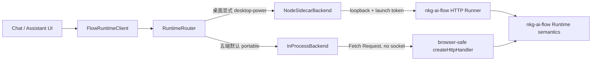

# Runtime 路由架构

> 当前实现证据、体积基线和剩余风险见
> [`implementation-audit-2026-07-20.md`](./implementation-audit-2026-07-20.md)。

## 已确定的边界

应用上层只依赖 `FlowRuntimeClient`，不感知 Flow 最终运行在 Node sidecar
还是移动端进程内 Runtime。路由以 `nkg-ai-flow` 已有的 Fetch/HTTP 协议为
统一契约：

- Windows、macOS、Linux、Android、iOS：默认使用 `portable`，同一个
  `Request` 直接交给进程内 browser-safe `createHttpHandler()`；
- Windows、macOS、Linux：只有显式选择 `desktop-power` 时才启动 Node
  sidecar，并把相对路径请求代理到随机 loopback 端口；
- invoke、stream、Run 查询、事件回放和取消均由同一客户端实现；
- 平台判断由 Tauri 原生宿主显式注入，不使用 UA 猜测；
- 当前适配代码属于 `nkg-ai-bot`，稳定且证明可复用后才考虑上移
  `nkg-ai-flow`。



## 当前代码

`packages/runtime-router` 已提供：

- `RuntimeRouter`：按平台选择 backend，惰性启动、并发启动去重、停止和失败重试；
- `NodeSidecarBackend`：只接受 HTTP loopback URL，自动附加每次启动的 token，
  禁止上层传入绝对 URL；
- `InProcessBackend`：构造标准 Fetch `Request` 并直接调用内存 handler；
- `FlowRuntimeClient`：注册 Flow、invoke、invokeNode、SSE stream、Run 查询、
  事件回放和取消；
- `parseServerSentEvents`：可处理跨数据块的 SSE 消息。

桌面请求遇到 sidecar 网络级失败时，Router 不会自动重放原请求，因为失败的 POST
可能已经产生副作用；它会先回收并失效旧 backend，让下一次用户操作创建新 sidecar。
由调用方主动取消的请求不会触发重启。

每个成功启动的 backend 都有单调递增的 generation。新 sidecar 的内存 Flow 目录为空，
所以应用执行 invoke/stream 前会检查 generation；发现 backend 已更换时，先从本地
SQLite 重新注册全部 Flow，再执行这次新的用户操作。恢复期间若 backend 再次变化，
目录补水会重试，但最多三代，避免故障循环无限阻塞 UI。

流式响应必须出现 `run_finished`、`run_failed` 或 `run_cancelled` 终态事件。连接报错或
未出现终态就结束会产生结构化 `RuntimeTransportError`，并在桌面端失效产生该 Response
的原 sidecar。Response 与 backend 的关联使用实例级 provenance，旧流不会误杀已经
并发启动的替代进程。聊天页会清除未持久化的半截回复，并明确提示当前操作不会自动
重放；显式取消则显示为正常停止，而不是底层异常。

`packages/tauri-runtime-adapter` 已提供应用组合入口：五端默认注入进程内
handler factory；桌面增强模式再把
`runtime_sidecar_start` / `runtime_sidecar_stop` 两个 Tauri command 适配为
`SidecarLauncher`。UI 只拿到
同一个 `FlowRuntimeClient`。

应用启动后，`runtimeCatalog` 从本地 SQLite 读取 Flow graph，并通过同一个
`FlowRuntimeClient.registerFlow()` 注册到当前 backend。单条坏 Flow 会进入可见的
降级状态，其他有效 Flow 仍然可用；本地目录本身无法读取则视为启动失败。
首次启动会以“不覆盖同 ID/版本本地修改”的策略补入 `builtin_chat@1.0.0`。日常聊天
页面把本地历史拼成单次 prompt，消费该 Flow 的 `stream_delta`，成功结束后再把完整
助手消息写入 SQLite；失败或取消不会把不完整的助手文本持久化。

Android/iOS 通过 Tauri 的 `tauri://suspended` / `tauri://resumed` 窗口事件接入
统一生命周期协调器。挂起时先向所有已知的活动 run 发送 cancel，再中止 invoke/SSE
请求；恢复时确认 Router 已启动并重新同步 SQLite Flow 目录。事件串行处理，避免
快速切换前后台导致恢复与挂起互相覆盖。桌面端不注册这组移动监听器。

## Tauri 接入实现

桌面端的 `SidecarLauncher` 已由 Rust command 实现：

```ts
interface SidecarLauncher {
  start(): Promise<{ baseUrl: string; token: string }>;
  stop(): Promise<void>;
}
```

原生宿主在 `start()` 时完成以下工作：

1. 生成加密安全的随机 token；
2. 让操作系统选择随机空闲端口，只绑定 `127.0.0.1`；
3. 启动随安装包分发的 sidecar，并通过进程环境/标准输入传入 token；
4. 等待带超时的 ready 握手，再返回 URL 和 token；
5. sidecar 对每个请求验证 token，拒绝无 token 请求；
6. stop、进程异常和主应用退出时清理状态与子进程。

默认 `createInProcessHandler()` 直接调用 nkg-ai-flow 提供的
`createPortableHttpRuntime()`，负责创建 browser-safe Runtime、注册本地 Flow，
并返回同包的 Fetch handler。它不得导入 Node
builtin、`agentTools.node`、HTTP Runner、CLI、MCP 或子进程实现；可以发布
`tool` / `agent` 契约，但必须由 capability 与宿主 ToolHost 决定能否执行。

## 本地数据与网络边界

- SQLite 保存 provider profile、角色、Flow、助理、会话、消息和非敏感设置；
- SQLite 只保存 `api_key_ref`，API Key 本体写入 Stronghold 加密快照；
- Stronghold 由用户设置的本地 vault 密码解锁，代码中没有默认密码或云端恢复；
- provider URL 只允许 HTTP/HTTPS 且禁止 URL 内嵌账号密码；
- Android/iOS 将 Tauri Rust HTTP backend 作为显式 `fetch` 依赖注入 Runtime、
  HTTP 节点和 AI SDK Provider，不修改 `globalThis.fetch`，因此模型调用既不依赖
  WebView CORS，也不会污染 WebView 中其他库；
- 原生 HTTP scope 使用 `https://*:*` / `http://*:*`，允许用户自定义的 HTTPS 或
  HTTP provider 及非默认端口，包括本机与局域网服务；`http://*` 只覆盖默认端口，
  已由 Android 实机化 Emulator 门禁发现并回归锁定；HTTP 明文地址由用户主动配置，
  设置页需要持续提示传输风险；
- Authorization 等模型 API header 由 Rust backend 发送，API Key 只在单次 Flow
  run 前从 Stronghold 解密并注入，不写入 SQLite、Flow graph 或日志。

## 实现进度

已完成：

1. `nkg-ai-flow` 包根 `@ai-native-flow/runtime` 已默认导出 portable Runtime；
   `/portable` 是显式基础设施入口，`/browser` 保留为兼容别名，Node 原生能力只从
   `/node` 的 `createNodeRuntime()` 到达；
2. 五端 builtin registry 都发布 `agent` / `tool` 契约；执行权限由 capability
   preflight 与受限 `AgentToolHost` 控制，缺少宿主时使用 deny-all host；
3. Artifact hash 和 HTTP override version 已改用 Web Crypto；
4. HTTP Runner 支持每次启动的 bearer token，发现页和 Runtime 路由均受保护；
5. 同一 Flow graph 已分别通过 sidecar 路径与进程内路径 contract test；
6. 浏览器实际打包校验已覆盖包根默认入口，证明 portable 业务入口没有 Node builtin import。
7. Tauri 2 React 客户端、Rust command、Node self-contained executable 和
   external binary 配置已完成；
8. 随机端口、临时 bearer token、ready timeout、loopback 校验、停止与退出清理已完成；
9. sidecar 二进制 E2E 已验证无 token 为 401、有效 token 为 200；
10. SQLite migration、Stronghold vault abstraction 与移动原生 HTTP adapter 骨架已完成；
11. Windows Tauri debug application 已完成真实编译，桌面首屏与移动 Runtime 已拆包；
12. Provider/API Key 设置页已接入 SQLite + Stronghold，选中 Provider 会在请求前
    延迟注入 `LLM_BASE_URL`、`LLM_DEFAULT_MODEL` 与 `LLM_API_KEY`；
13. 角色、Flow、助理、会话与消息 repository 已实现，消息序号和会话更新时间由
    SQLite 单语句/trigger 保证；
14. Android Studio 工程已初始化，Windows 构建脚本可自动准备目标 ABI 的
    libsodium，并已产出包含 `arm64-v8a` Rust runtime 的 Debug APK；
15. SQLite Flow 目录已在启动和移动端恢复时同步到统一 Runtime，单 Flow 失败会
    显示降级状态；
16. 移动生命周期已接入 Tauri 原生 suspended/resumed 事件，真实进程内 Runtime
    contract test 已证明挂起会把长任务 run 转为 `cancelled`；
17. Android 16 x86_64 Emulator 已完成 APK 安装与启动门禁，实际页面确认
    `android / in-process / 前台运行`；HOME → resume 的设备日志按顺序出现
    `suspending / suspended / resuming / active`，Stronghold 解锁、SQLite Provider
    保存及 `secrets.hold` 创建均通过；
18. 内置 `builtin_chat`、本地会话/消息持久化和流式聊天 UI 已接通；真实 Android
    WebView + Tauri Rust HTTP + 进程内 Runtime + AI SDK + OpenAI-compatible SSE 的
    端到端门禁已收到并持久化 `Android 原生 HTTP 与 Flow 流式执行成功。`，请求日志
    同时证明自定义 URL、模型 ID、`stream: true` 与 Bearer Token 均正确到达 Provider；
19. Android 原生 HTTP scope 已修正为支持用户自定义端口，并有配置回归测试。
20. Android/iOS 已用平台配置覆盖桌面构建命令，移动构建只生成 browser-safe
    frontend，且 `externalBin` 为空；Android 实际构建已证明 sidecar 文件时间与哈希
    均保持不变；
21. sidecar 目标解析已覆盖并校验 Windows x64、macOS arm64/x64、Linux
    arm64/x64 的 Rust host tuple、yao-pkg target 与 Tauri 文件名；Unix 产物显式设置
    executable bit；
22. 桌面 sidecar 请求级崩溃恢复已实现：不重放失败请求、清理旧进程、下一请求重新
    启动；取消请求保持现有进程；
23. Windows/macOS/Linux CI matrix 已连续通过平台无关 contract、宿主 sidecar
    构建、Bearer 鉴权/ready E2E 并上传三元组产物；它仍不能替代完整 Tauri portable
    Release 应用和真实桌面启动验收。
24. Android 与 iOS 两个平台标识均通过同一真实进程内 Runtime contract：活动 Flow
    在挂起时转为 `cancelled`，内置聊天 Flow 通过 OpenAI-compatible HTTP/SSE 收到
    有序文本；这证明共享 TypeScript/Runtime 语义，不等同于 iOS 原生宿主验收。
25. 桌面中断恢复已补齐到应用层：请求失败和无终态 SSE 均结构化分类且不自动重放；
    replacement sidecar 会在下一次用户操作前按 generation 重新注册本地 Flow。组合
    contract 已证明顺序严格为“失败一次 → 新 sidecar 注册 Flow → 新 invoke”。
26. Provider 设置交互已补强：明文 HTTP 每次保存都必须显式确认，已保存的 HTTP
    profile 持续显示风险标记；删除 profile 需要二次确认并说明 API Key 同步移除；
    Stronghold 解锁失败使用稳定错误码和不泄漏插件细节的可操作提示。Android WebView
    E2E 门禁也已改为必须新增一条持久化助手消息，避免历史回复造成假阳性；受控 mock
    回归证明 HTTP 确认后 Bearer Token、模型 ID、SSE 与本地持久化仍正常。
27. Android Emulator 已加入慢速真实网络生命周期门禁：Provider 以 2 秒间隔发送
    SSE 分块，收到首块后由 ADB 发送 HOME。设备日志证明
    `suspending → suspended → resuming → active`；进行中的 Provider 连接以
    `completed:false` 关闭，半截回复未持久化，显式取消竞态归一化为友好的
    `AbortError`，恢复后的下一次聊天收到完整回复并写入 SQLite。E2E 脚本会自行清理
    DevTools forward 与 Provider reverse，且断言只检查本次新增消息。
28. 移动 Release 已纳入本地发布链路：Windows 默认生成 Android arm64 APK，准备
    Google Play 上传时通过 `--android-aab` 额外生成 AAB；移动构建不会打包桌面 Node
    sidecar。macOS 负责生成 DMG 与需要真实签名环境的 App Store Connect IPA。
29. Android 构建默认使用 Release，显式 `--debug` 才生成调试包；Release APK 同时执行
    40 MiB 体积预算。启用符号裁剪、Thin LTO、R8 和资源裁剪后，arm64 本地基线由
    241.12 MiB Debug 降至 14.83 MiB Release APK / 8.45 MiB Release AAB；后续发布
    尺寸只能以 Release APK/AAB 衡量。
30. Desktop sidecar、Shell 插件及其 `serde` / `tokio` / `url` / `uuid` 依赖已改为
    desktop target 条件依赖；Android/iOS Cargo graph 均不再包含 Shell/open/shared_child，
    Android 生成的 Gradle 工程也只装配 `tauri-android`。裁剪后的 arm64 基线进一步降为
    14.34 MiB Release APK / 8.21 MiB Release AAB。
31. Portable Runtime 已接入 SQLite `RunStore`、`RegistryStore`、`ArtifactStore`、
    `EventStore` 与 `VariableStore`；Flow、Run、artifact、事件游标和 checkpoint 可跨
    应用重启恢复，请求级 Provider 覆盖不会把 API Key 写入普通变量表。
32. `RuntimeMode` 已统一为 `portable | desktop-power`；Windows、macOS、Linux、
    Android、iOS 默认均为 portable，移动端显式请求 desktop-power 会立即拒绝。
33. `nkg-ai-flow` 已实现 capability manifest、节点能力元数据、注册前和执行解析前
    preflight；错误包含平台、节点 ID、节点类型和完整缺失能力清单。
34. Tauri ToolHost 当前只开放应用本地 `tool-workspace` 中的 `list_files`、
    `read_file`、`grep`；TypeScript 与 Rust 两侧分别校验 allow-list，Rust 额外拒绝
    绝对路径、父目录、符号链接逃逸、写文件和进程启动。
35. HTTP 与 LLM Provider 已改为显式注入宿主 fetch；Android/iOS 使用 Tauri 原生
    HTTP，桌面 portable 使用宿主 Web fetch，全局 fetch 覆盖已删除并有回归测试。
36. 主仓库仅通过 `@ai-native-flow/*` 公共 exports 消费 submodule；顶层统一 npm
    workspace/lockfile 取代 CI 中重复的两次 `npm ci`，并有禁止源码深路径导入门禁。
37. 当前本地 arm64 Release 基线为 14.39 MiB APK；可选 Google Play AAB 为 8.23 MiB。
    默认 Release 归档不会收集 AAB。历史 241.12 MiB 是包含符号与未优化依赖的 Debug
    APK，不再作为发布体积指标。
38. `@ai-native-flow/runtime` 包根已切换为 portable `createRuntime()`；Tauri persistence、
    ToolHost 和移动生命周期代码均从包根消费统一契约，只有 desktop-power 对照路径显式
    导入 `@ai-native-flow/runtime/node`。
39. portable 与 Node 工厂均有默认 capability manifest；不兼容 Flow 无需业务层手工
    传参即可在注册阶段失败。

尚待实现：

1. Android 物理真机验证外部 Provider 流式模型响应，并复核已在 Emulator 通过的
   Stronghold、前后台取消/目录恢复策略；
2. 完成 iOS 真机同 Flow contract gate；当前 CI 证据是 arm64 Simulator Release，
   不是签名真机包；
3. 在 Windows、macOS、Linux 构建完整 Tauri portable Release 应用；当前桌面矩阵
   已验证 sidecar 和平台无关契约，但不能替代安装包启动验收；
4. 将 portable Runtime 下沉到 Web Worker，验证长 Flow 不阻塞 UI；
5. 为用户选择目录、写文件和其他高权限工具补充逐次确认；在此之前保持只读；
6. 在 Studio 中消费 capability inspection，显示 badge 和运行前兼容性报告。
