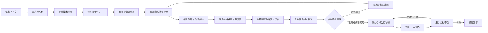

# 电脑配置顾问 Flow V4 重构策略

## 1. 目标

V4 不再把“生成技术配置”“搜索实时商品”“预算收敛”“生成最终回答”混在一条脆弱链路里。核心目标是：

1. 用户要求推荐时，始终先交付覆盖全部目标部件的完整清单。
2. 商品核价可以全成功、部分成功或全部失败，但不能导致清单缺行或运行中断。
3. “技术推荐完整度”和“实时商品核验覆盖率”分别建模，不能再用一个 `budgetStatus` 同时表达两件事。
4. 只有型号、品类、价格和推广链接都通过校验的商品才能称为“已核验”。
5. 最终回答的必备结构由确定性节点生成；LLM 只做可选润色，失败时直接返回确定性报告。
6. 所有假设、风险和需要用户决定的事项统一放在报告末尾，最多三组。
7. LLM 不生成任何会进入联盟 API 的价格上下限；联网检索只建立当前技术型号候选池，当前价格必须由联盟商品 API 核验后再参与预算收敛。

## 2. 不可破坏的系统约束

### 2.1 完整交付约束

- `diy_full`：必须覆盖 CPU、散热器、主板、内存、显卡、存储、电源、机箱；明确包含外设时再增加显示器、键盘、鼠标。
- `parts` / `upgrade`：必须覆盖全部 `targetParts`，但不能擅自补齐整机。
- `prebuilt_desktop` / `laptop`：必须给出完整整机 SKU 或明确规格方案。
- 商品没有查到时，保留技术推荐，价格状态写为“系统本轮未匹配到实时商品”；不得要求用户代替系统逐项搜索、核价或核验。
- 任一外部服务失败都不得删除已经形成的技术方案。

### 2.2 证据约束

- 百分比预算只能作为内部技术优先级权重，不能提前换算成各部件人民币区间，也不在最终商品价格列中展示。
- 模型知识、历史比例和预算槽位都不能作为联盟搜索的 `minPrice` / `maxPrice`，也不能用于判断实时商品价格是否异常。
- 只有 `fully_verified` 商品才能展示真实价格和推广链接。
- “API 返回”不等于“型号核验通过”。
- 未知规格是 warning；明确冲突才是 error。
- 商品标题、店铺名和外部搜索内容只能作为不可信数据，不能改变 Flow 指令。

### 2.3 失败隔离约束

- 需求解析失败：使用规则化默认需求，继续生成基础方案。
- 商品服务失败：输出完整技术清单，核价覆盖率降级为 0。
- 部分商品失败：保留已核验商品，其余部件继续显示技术推荐。
- 预算优化失败：输出完整方案并说明预算冲突，不得返回空数组。
- 最终 LLM 失败、超时或流式中断：直接返回确定性 Markdown 报告。

## 3. 当前 V3 的结构性问题

1. 需求规划、技术规划、两轮修正和最终回答共 5 个 LLM 节点的 error 端口都没有恢复分支；任一节点失败都会让主链没有最终报告。
2. 技术规划和电商查询共用一份精确型号计划，导致“技术上想买什么”与“平台能搜到什么”相互绑死。
3. 预算槽位最高价直接进入拼多多 API，价格发现之前就可能把真实商品全部排除。
4. 每个槽位首轮通常只有一个精确查询，没有型号族、规格词和替代型号的查询阶梯。
5. 当前相关性只要求任意关键词命中，`1TB` 等通用词即可让错误品类通过。
6. 查询计划中的 `requiredSpecs` 会被复制到商品上，计划规格和商品实证混在一起，兼容校验可能把“希望它具备”误认为“已经证实具备”。
7. 商品搜索与推广转链强耦合；一个候选转链失败可能让同一查询中其他已找到的候选一起丢失。
8. 修复轮次只选择缺失列表前 3 项，后面的部件没有公平的重试机会。
9. `selectedProducts`、`selectedTotal` 和 `budgetStatus` 同时承担完整度、核价覆盖和预算结论，状态含义混乱。
10. 商品节点只记录最终接受数量，没有记录平台原始返回数、过滤数量和拒绝原因。
11. 最终报告依赖一个流式 LLM 节点，没有结构校验和可直接交付的 fallback。
12. 即使取消 API 价格范围，旧 `targetPrice` 仍参与商品评分和修复目标选择，错误估价会继续影响最终选品顺序。
13. 当前价格契约没有区分精确 SKU 价、商品链接起价和条件券价，拼多多最低团购价可能被过度解释为目标变体成交价。

## 4. V4 目标 Flow



V4.3 使用 Runtime 原生 `loop_begin` / `loop_end` 包裹“调度—联盟搜索—优化”循环体，不再静态复制十套节点。循环状态保存逐槽尝试、联盟遥测、市场聚类、候选池和预算选择；覆盖完成、服务不可用、语义阶段耗尽、40 次查询上限或 90 秒墙钟上限任一成立即退出。循环最大 10 轮，模型不能自行扩大次数、权限或时间上限。

## 5. 节点职责和数据契约

### 5.1 `computer_requirement_policy_v2`

职责：识别场景、预算、目标部件、复用件和偏好，但不因普通信息不足中断推荐。

策略：

- 缺用途：默认 `balanced`。
- DIY 未说明外设范围：默认 `tower`。
- 有预算：进入实时核价流程。
- 无预算：仍进入技术蓝图流程，使用分档或基准方案，不进入实时商品优化。
- 真正无法识别目标部件时才标记 `needs_user_decision`，但仍输出当前能成立的参考方案。

### 5.2 `computer_blueprint_planner`

职责：只生成完整技术方案，不调用电商，不声称实时价格。

每个槽位必须包含：

```ts
interface BlueprintSlot {
  slotId: string;
  partType: ComputerPartType;
  required: boolean;
  primaryModel: string;
  alternatives: Array<{
    model: string;
    direction: "lower_cost" | "higher_performance";
  }>;
  requiredSpecs: Record<string, unknown>;
  reason: string;
  utilityWeight: number;
  performanceTier: "economy" | "balanced" | "performance";
}
```

蓝图只表达性能层级、技术优先级和可接受替代方向，不输出人民币估价。进入蓝图规划前，客户端的电脑硬件专项搜索会优先检索当前 CPU/平台、显卡和关键规格资料；规划器据此输出一个主型号与降本、升级两个完整型号。网页结果只用于确认型号存在、发布状态和技术定位，网页价格不能进入核价结果。

### 5.3 `computer_blueprint_guard`

职责：确定性检查目标部件是否全部有行。

- 缺行时用工作负载模板补齐明确规格，不允许直接进入商品搜索。
- 检查 CPU/主板插槽、内存代际、电源功率、板型和尺寸等可静态判断的约束。
- 输出 `configurationCoverage`，进入后续节点时必须为 `required === planned`。

### 5.4 `commerce_query_scheduler`

职责：为每个槽位生成有层次的查询队列，并保证所有槽位公平获得尝试机会。

每个槽位的查询阶梯：

1. `exact_model`：先用联网技术蓝图确认的主型号身份词精确检索，例如“9950X”“RTX 5070”“B650M MORTAR”；不要把完整英文品牌名和长品类描述拼进拼多多关键词，也禁止只搜“CPU”。
2. `approved_alternative`：主型号无召回时，依次精确检索蓝图中批准的降本与升级型号。
3. `market_discovery`：三个具体型号均召回不足时，才使用“板U套装”“独立显卡”“台式机内存条”等平台品类词做补漏采样；结果只进入市场样本池，不能直接算已核价。
4. `market_confirmation`：从补漏样本标题提取真实在售型号并聚类，再用最有代表性的聚类身份词精确复搜；只有复搜商品通过品类、型号和价格校验后才能进入候选池。若补漏没有形成有效聚类，最后一次尝试使用带品类别名的 `model_family`，不允许无型号锚点的规格词商品直接核价。

调度约束：

- 先保证每个必需槽位至少执行一次，再安排第二次尝试。
- 每批最多 4 个槽位并发；每个槽位最多 5 次有界尝试，整套默认最多 40 次；先保证所有必需槽位完成同一层精确型号查询，再公平进入下一候选层和市场补漏阶段。
- 前三次基础查询分别对应主型号、降本型号和升级型号；完整组合超预算时，优化器仍可单独请求一次方向明确的替代查询。
- 每个发现查询在条件允许时保留最多 5 个语义合格商品样本，按型号聚类并记录最低价、中位数和最高价，避免用单个最低价代表整个型号。
- 板U套装作为一个商品覆盖 CPU 和主板两个槽位参与全局优化，只计价一次；报告的次要槽位标记为“已包含于同一套装”。
- 所有价格发现查询都不传 `minPrice`、`maxPrice` 或拼多多 `range_list`。用户总预算只进入本地组合优化器。
- 查询词只由型号、型号别名、品类和关键规格组成，不能包含模型生成的价位描述。
- 已尝试的关键词、阶段和拒绝原因必须进入状态，禁止无变化重复查询。
- 每轮必须读取上一轮遥测后再选择下一阶段：原始返回为空时切换批准的具体型号；原始有货但全部因品类/型号被拒绝时提前进入市场发现；发现有效型号聚类后优先进入精确确认。循环负责反馈，查询策略仍由确定性代码约束，不允许 LLM 自由生成无限查询。
- 达到 20～25 秒墙钟上限时停止核价。单波没有新增合格候选只能推进到尚未尝试的下一语义阶段；只有未解槽位均已耗尽阶段，或连续无进展且没有可执行的新阶段时，才转入降级报告。

电脑顾问使用专用、类型上不包含价格字段的查询契约；通用联盟 Flow 仍可保留显式价格过滤，避免破坏其他业务：

```ts
interface ComputerCommerceQuery {
  queryId: string;
  slotId: string;
  coveredSlotIds: string[];
  partType: ComputerPartType;
  stage: "market_discovery" | "market_confirmation" | "exact_model" | "model_family" | "spec_fallback" | "approved_alternative";
  keyword: string;
  modelAnchors: string[];
  categoryAnchors: string[];
  negativeTerms: string[];
  attempt: number;
  discoveryMode: "unbounded";
  count: number;
}
```

### 5.5 `commerce_candidate_verifier`

职责：把“平台商品”升级为“可用于推荐的已核验商品”。

校验阶段：

1. `provider_returned`：平台返回有效商品标识和价格。
2. `category_matched`：品类必须一致；内置 NVMe 不能被 USB 移动固态替代。
3. `model_matched`：精确阶段必须命中品牌/型号核心锚点，不能只命中容量等通用词。
4. `price_observed`：价格为正、单位正确，商品变体与目标规格没有明显冲突。
5. `compatibility_passed`：候选与蓝图硬约束没有明确冲突。
6. 优化器选中后再由推广节点补充 `link_generated`；成功后才达到 `fully_verified`。

```ts
interface CandidateVerification {
  plannedSpecs: Record<string, unknown>;
  observedSpecs: Record<string, unknown>;
  observedSpecSources: string[];
  checks: {
    category: boolean;
    model: boolean;
    variant: boolean | "unknown";
    priceComparable: boolean;
    compatibility: boolean | "unknown";
    linkGenerated: boolean;
  };
  eligibleForOptimization: boolean;
  fullyVerified: boolean;
  rejectionReasons: string[];
}
```

只有 `fully_verified` 候选可以出现在推广商品表。

`plannedSpecs`、`observedSpecs` 和可信目录规格必须分开保存。只有带来源的 `observedSpecs` 或可信目录规格可以证明商品兼容；规划器写下的期望规格不能回填成商品事实。

### 5.6 `commerce_price_discovery`

职责：从语义匹配的联盟商品中建立当前价格证据，不使用模型记忆价做判断。

```ts
interface PriceObservation {
  provider: CommerceProvider;
  productId: string;
  modelKey: string;
  listedPrice?: number;
  promotionalPrice?: number;
  budgetComparablePrice?: number;
  priceKind: "sku_price" | "listing_min" | "listing_floor_only" | "conditional_coupon";
  capturedAt: string;
  variantMatched: boolean | "unknown";
  couponEligibility: boolean | "unknown";
  sampleCount: number;
  confidence: "high" | "medium" | "low";
  anomalyReasons: string[];
}
```

价格策略：

- 不拿模型估价、历史均价或预算份额判断商品“太贵/太便宜”。
- 先通过标题语义排除定金、补差价、租赁、包装、支架、硬盘盒、外壳、单配件、错误容量和错误变体。
- 同一规范化型号有多个合格商品时，使用中位数和 MAD/IQR 识别统计异常；不能用最低单价直接代表该型号正常价。
- 只有一个样本时允许保留，但置信度为 `low`，报告必须说明它是单样本平台价。
- 拼多多 `min_group_price` 若商品标题包含多个容量/版本，只能称为“平台最低拼团价/起价”，不能声称是目标变体成交价。
- `listing_floor_only` 和未确认资格的 `conditional_coupon` 不得写入 `budgetComparablePrice`，也不得用于证明整机满足硬预算。
- 硬预算优先使用已匹配目标变体、无需额外资格的团购/挂牌价格；券后价可以另外展示，但不能默认用户一定满足领券条件。
- 可选的公开网页价格只能辅助发现候选或识别明显异常，不能替代联盟 API 成为最终推广价格。

### 5.7 `computer_recommendation_optimizer_v2`

职责：在真实价格候选池形成后做全局组合选择，不负责决定报告是否完整。

- 唯一的初始金额约束是用户整机/目标部件总预算；不存在预先固定的部件人民币上限。
- 使用多选背包或 Pareto 前沿，从每槽真实候选中选择兼容组合，最大化按 `utilityWeight` 加权的技术效用并满足总预算。
- 允许部件之间动态借用预算：某槽位高于旧百分比分配不构成失败，只要整套仍在总预算内。
- 首轮主型号组合超预算时，根据真实候选计算“可节省金额 / 技术效用损失”，再调度 `lower_cost` 替代型号查询。
- 整套明显低于预算时，才按效用增益调度 `higher_performance` 替代型号；升级仍须重新取得真实价格。
- 一个槽位没有价格候选时保留蓝图推荐，不能把整套选择清空；此时预算状态只能是 `partially_priced`，不能推算已满足硬预算。
- 核价不全时只输出已核验小计和待核价槽位数，不用模型估价补出“预计整机总价”。
- 兼容性 unknown 进入末尾核对项，明确冲突才触发换候选或替代型号。
- 商品排序删除“离旧槽位目标价越近越好”的惩罚；同等技术效用和可信度下优先可靠实价更低者，而不是刻意把预算花满。
- CPU 跨平台替代时，CPU、主板和内存作为一个平台包共同优化，不能只换其中一件。

### 5.8 `commerce_promotion_resolver`

职责：只为优化器选中的、已通过品类/型号/价格校验的 shortlist 生成推广链接。

- 搜索结果先落状态，再进行转链，避免转链失败抹掉已发现候选。
- 逐商品使用等价于 `allSettled` 的隔离策略；单商品转链失败只能影响该商品的 `linkStatus`。
- 转链错误可单独重试两次，不重新执行已经成功的商品搜索。
- 价格已观察但转链失败的候选可以保留为诊断证据，但不能出现在最终推广商品表。

### 5.9 `coverage_policy`

使用相互独立的状态：

```ts
interface RecommendationCoverage {
  configuration: { required: number; planned: number };
  pricing: { required: number; observed: number; budgetComparable: number; exhausted: number };
  links: { verified: number };
  compatibility: "passed" | "warning" | "blocked";
  budget: "verified_within_budget" | "verified_over_budget" | "partially_priced" | "unknown";
  delivery: "ready" | "degraded";
  answerReady: true;
  stopReason: "all_slots_verified" | "attempts_exhausted" | "no_progress_after_stage_exhaustion" | "wall_clock_exhausted" | "call_budget_exhausted" | "provider_unavailable" | "cancelled";
}
```

停止条件：

- 所有槽位已核验；或
- 所有未核验槽位都已耗尽尝试；或
- 达到总调用数/总耗时上限。

无论哪种停止条件，`delivery` 都必须能够进入报告组装器。

一旦蓝图通过完整性守卫，`answerReady` 必须保持为 `true`，后续任何节点不得将其清空。

### 5.10 `computer_report_assembler`

职责：不用 LLM，确定性生成可直接交付的 Markdown。

固定顺序：

1. 推荐结论。
2. 完整配置表。
3. 已核验商品和推广披露。
4. 预算状态。
5. 兼容性与替代方案。
6. 问题与待确认项（最后，最多三组）。

配置表每个目标槽位恰好一行：

- 已核验：真实商品名、真实价格、推广链接和查询时间。
- 未核验：蓝图型号/规格、价格写“系统本轮未匹配到实时商品”；不使用模型估价或人民币预算槽位补值，也不把该状态转成用户任务。
- 核价不全：可以显示“用户总预算 − 已核验小计”的剩余预算上界，但不能把它当作未核价部件的预计价格。
- 不允许生成不存在于 `fully_verified` 集合中的链接。

### 5.11 `report_polisher` 与 `report_guard`

- 润色模型只接收已经完整的报告，不重新选型、不改价格、不新增链接。
- LLM 节点启用一次运行时重试。
- 守卫检查目标部件行数、真实价格来源、链接白名单、问题章节位置和最大问题数。
- 润色失败、流式中断或守卫不通过时，使用显式 fallback 返回确定性报告。
- 润色必须先完整缓冲再经过守卫，不能把未经验证的流式文本直接展示给用户。

## 6. 容错矩阵

| 失败点 | V4 行为 | 对用户的结果 |
|---|---|---|
| 需求 LLM JSON 无效 | 规则化默认需求 | 完整基准方案，末尾提示默认假设 |
| 技术蓝图缺行 | 蓝图守卫按模板补齐 | 清单仍完整 |
| Token 失效且刷新失败 | 商品分支降级 | 完整清单，所有价格待核价 |
| 部分查询为空 | 调度下一层查询或替代型号 | 已核验与待核价混合展示 |
| 返回错误品类 | 候选拒绝并记录原因 | 错误商品不进入报告 |
| 推广转链失败 | 单独重试，不清空搜索结果 | 不展示该商品链接 |
| 完整组合超预算 | 选择批准的替代型号并重查 | 给出完整替代方案和预算冲突 |
| 最终 LLM 超时/中断 | fallback 到确定性报告 | 本轮仍成功返回完整报告 |

Runtime 的 `succeeded=true` 只表示执行链有可交付输出，不等于业务已完全核价。业务完成度必须由 `RecommendationCoverage` 与 `stopReason` 单独判定；`delivery=degraded` 也必须返回成功的确定性报告。

## 7. 可观测性

每次运行必须能按槽位回答“查了什么、平台返回多少、为何被拒绝、下一步做什么”。

商品节点摘要增加：

```ts
interface SlotSearchTelemetry {
  slotId: string;
  attempt: number;
  stage: "market_discovery" | "market_confirmation" | "exact_model" | "model_family" | "spec_fallback" | "approved_alternative";
  keyword: string;
  providerRawCount: number;
  rejectedByCategory: number;
  rejectedByModel: number;
  rejectedByPrice: number;
  promotionFailed: number;
  fullyVerified: number;
  acceptedNewCount: number;
  queryFingerprint: string;
  latencyMs: number;
  nextAction?: string;
  exhaustionReason?: string;
  errorCode?: string;
}
```

运行总览固定展示：

- `configurationCoverage`，例如 `8/8`。
- `pricingCoverage`，例如 `1/8`。
- `linkCoverage`，例如 `1/8`。
- 各槽位尝试次数和最终状态。
- 降级原因和总耗时。
- 优化器访问的组合数、最佳实价总额、覆盖率变化和候选集合摘要哈希。

日志和状态中不得保存 Access Token、Refresh Token、Client Secret 或签名原文。

运行历史持久化必须批量、事务化写入终态与事件；逐 Token 的 thinking/text delta 应聚合或采样，避免应用退出时留下“Run 已成功但事件只有截断前缀”的假完整日志。业务检索遥测应作为独立、耐久的结构化事件保存。

## 8. 迁移计划

V4 使用新 Flow 版本实现，不原地修改已发布的 V3 图；V3 保留为可回滚版本。

### 阶段 A：先保证永不丢报告

1. 引入 `BlueprintSlot` 和独立覆盖率状态。
2. 新增蓝图完整性守卫。
3. 新增确定性报告组装器、报告守卫和 fallback。
4. 为所有 LLM 节点增加有限重试和显式错误降级路径。
5. 覆盖需求/规划 LLM 失败、最终 LLM 超时和流式中断测试。

完成后，即使商品模块完全不可用，也必须稳定返回完整技术清单。

### 阶段 B：重做商品核验与重试

1. 查询改为分层阶梯。
2. 添加硬品类和型号锚点校验，并分离计划规格与商品实证。
3. 推广转链移到语义校验之后，逐商品隔离失败。
4. 修复调度改为按槽位轮换，并记录尝试历史。
5. 添加原始数量、拒绝原因和转链结果遥测。

### 阶段 C：真实价格驱动的预算收敛

1. 从蓝图和联盟查询中彻底移除模型生成的人民币区间。
2. 先按型号/品类无价格过滤地发现真实候选，并建立多商品价格样本与置信度。
3. 使用用户总预算和真实候选池做全局组合优化，允许跨槽位动态借用。
4. 超预算时按真实节省金额与技术损失选择批准的低成本替代型号并重新核价。
5. 分开输出已核验小计、待核价项和价格置信度；核价不全时不推算整机总价。

### 阶段 D：影子验证与发布

1. 使用固定场景集并行运行 V3/V4，不向用户展示 V4 影子结果。
2. 达到验收门槛后，将内置助手切换到 V4。
3. 保留 V3 作为 previous version，可一键回滚。

## 9. 验收标准

### 9.1 必过功能门槛

- 20 个推荐场景中，目标部件清单覆盖率必须为 100%。
- 拼多多 0 返回、部分返回和全部返回三种情况下，Flow 都必须成功结束并给出完整报告。
- 任一需求、规划、修正或最终 LLM 节点失败时，Flow 都必须进入降级报告而不是中断。
- 错误品类商品进入最终推广表的数量必须为 0。
- 任何真实价格都必须能追溯到本轮 API 返回和查询时间。
- 所有联盟价格发现请求都不得含模型生成的 `minPrice`、`maxPrice` 或 `range_list`。
- 预算参考冒充商品价格的数量必须为 0。
- 问题与待确认项必须位于最后且最多三组。
- 最终 LLM 失败或流式中断时，确定性报告必须可交付。

### 9.2 回归场景

1. 8000 元 2K 游戏完整主机，商品 8/8 命中。
2. 同一请求商品仅 1/8 命中。
3. 拼多多全部返回空。
4. Token 过期且刷新失败。
5. NVMe 查询返回 USB 移动固态硬盘。
6. 精确型号无结果、型号族有结果。
7. 推广转链单项失败。
8. 已核验完整组合超过硬预算。
9. CPU 与主板插槽明确冲突。
10. 只推荐 CPU + 主板的局部需求。
11. 旧机升级且已有 DDR4 内存。
12. 最终 LLM 输出缺行、篡改价格或新增链接。
13. 最终 LLM 超时和流式中断。
14. 模型给出的初始价位严重偏低，但联盟中的真实商品仍能被发现。
15. 某部件超过旧百分比分配、整套仍满足总预算时，组合必须被接受。
16. 同型号单个异常低价和多变体起价不能被当作目标型号的高置信度价格。
17. 电脑顾问 PDD 请求不得出现 `range_list`，JD 请求不得出现 `pricefrom` / `priceto`；通用联盟查询的显式范围仍保持可用。
18. 候选价格高于旧槽位上限或低于旧槽位下限时，只要型号正确且全局预算可行，仍必须进入候选池。
19. 单个推广转链失败不能清空同一查询中其他已发现商品。

## 10. 本次策略结论

V4 的核心不是增加更多重试，而是改变交付模型：

- 技术蓝图先完整，商品核验后增强。
- 每个槽位独立推进，不再让一个缺件拖垮整套。
- 核验是分阶段证据链，不再把“API 返回”当作“型号正确”。
- 价格先由联盟发现，再由总预算选择；模型不再为搜索设定价格边界。
- 最终报告先确定性生成，LLM 不再成为唯一出口。
- 完整度、价格覆盖、预算状态和兼容性分别表达，避免一个模糊状态控制所有结果。
