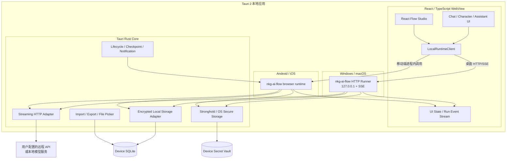

# nkg-ai-bot 本地优先产品、市场与技术可行性审查报告

> 修订日期：2026-07-20  
> 项目：`wqaetly/nkg-ai-bot`  
> 上游引擎：[`wqaetly/nkg-ai-flow`](https://github.com/wqaetly/nkg-ai-flow)  
> 硬性约束：无账号、无项目云端存储、无项目服务端；聊天、角色、Flow、记忆、配置均保存在用户设备上；API URL 与 API Key 由用户自行配置。  
> 本报告不构成法律意见或财务预测。

## 1. 执行摘要

### 1.1 修订后的产品定义

本项目不是 SaaS，也不是由项目方托管模型调用的 AI 服务，而是：

> **一款本地优先、BYOK、自带 Flow Runtime 的跨平台个人 AI 客户端。用户拥有数据、配置模型端点、创建角色，并在本机编排和运行 AI 助理。**

项目只分发应用本身，不提供账号、聊天同步、云数据库、模型代理、统一 API Key、云端 Flow Worker 或内容市场。

“纯客户端”不等于“完全离线”：

- 聊天记录、角色、Flow、记忆、运行日志和密钥只保存在本机；
- 用户选择远程模型 API 时，提示词仍会发送给该模型供应商；
- 用户连接 Ollama、LM Studio 等本机服务时，可以实现端到端本地；
- 应用必须明确显示当前请求发往哪个 URL，不能把“本地存储”宣传为“内容绝不离开设备”。

### 1.2 最终判断

**建议立项，综合可行性约 7.4/10。**

纯客户端约束降低了云基础设施、账号安全、服务端多租户、模型成本和数据运营压力，也形成“隐私 + BYOK + 可编排”的差异化；代价是：

- 首次配置门槛高；
- 不具备自动跨设备同步；
- 移动端后台长任务受系统限制；
- 需要把 Node-oriented 的 `nkg-ai-flow` 拆出 browser/mobile runtime；
- 无法依赖云端修复错误 Flow、集中风控或统一内容审核；
- 不同用户的 API 兼容性会成为主要支持成本。

### 1.3 可行性评分

| 维度 | 评分 | 判断 |
|---|---:|---|
| 用户需求 | 7.5/10 | BYOK、本地数据、多模型和角色/Agent 有明确的重度用户需求 |
| 差异化 | 7.5/10 | “本地数据 + 角色 + Flow Runtime”比普通聊天壳更清晰 |
| 桌面技术可行性 | 9/10 | Tauri、SQLite、原生 HTTP 与 TypeScript Runtime 很匹配 |
| Android 技术可行性 | 7/10 | Tauri 2 可覆盖，但需真机验证 WebView、流式 IPC 和生命周期 |
| iOS 技术可行性 | 6.5/10 | 不能依赖 Node 子进程，必须使用 browser-safe Runtime 和 Rust 插件 |
| 商业可行性 | 6.5/10 | 无模型差价，可采用买断/Pro 解锁；用户群更窄但成本更可控 |
| 隐私与安全 | 8/10 | 无项目云存储显著缩小数据面；本地密钥和导入 Flow 仍需严肃防护 |

## 2. 不可改变的产品原则

1. **Local-only storage**：项目方不接收、存储或同步用户聊天、角色、Flow、记忆和 API Key。
2. **BYOK/BYO Endpoint**：用户自行创建 Provider Profile，填写 API URL、API Key、模型名和兼容参数。
3. **No account**：首版不注册账号，不要求手机号或邮箱。
4. **No runtime server**：Flow 在设备内执行，不把 Flow 发到项目方服务器。
5. **No hidden proxy**：模型请求直接从设备发往用户配置的供应商。
6. **Portable data**：用户可以导出和导入加密的完整工作区。
7. **Least privilege**：导入的 Flow 不自动获得文件、网络、剪贴板或系统命令权限。
8. **Inspectable execution**：每次 Run 都能查看节点、外发域名、Token 用量、错误和耗时。

## 3. 市场可行性

### 3.1 市场存在，但目标用户不再是所有聊天用户

消费 AI 付费已被验证。Appfigures 对移动市场的估算显示，第三方通用助手自 2023 年以来获得约 7.26 亿美元消费支出；其 2025 行业报告对 2024 年 AI Companion 应用的估算为约 1.18 亿次下载、5500 万美元消费支出、收入同比增长 652%。这些是第三方商店估算，不是审计数据，但证明聊天、角色和陪伴需求真实存在。来源：[通用助手分析](https://appfigures.com/resources/insights/20250131/amp?f=1)、[AI Companion 报告](https://resources-cdn.appfigures.com/industry-reports/appfigures-rise-of-ai-apps-key-trends-shaping-2025-report-v2.2.pdf)、[估算方法](https://help.appfigures.com/en/article/how-appfigures-estimates-downloads-and-revenue-for-ios-and-android-apps-na7a2h/)。

本项目不适合与 ChatGPT、豆包、Kimi 等争夺零配置大众用户。目标用户应收窄为：

- 已经购买或能获取模型 API Key 的重度 AI 用户；
- 同时使用多个模型或本地模型的用户；
- 重视隐私、不希望聊天进入另一个平台账号的用户；
- 角色创作者、Prompt 玩家和工作流爱好者；
- 希望保留可迁移数据、避免平台锁定的开发者和专业用户。

### 3.2 推荐定位

> **本地数据、自由模型、可编排角色。一个完全由用户掌控的个人 AI 工作台。**

产品卖点的优先级应为：

1. 数据和 API Key 留在本机；
2. 支持任意 OpenAI-compatible API URL 与本地模型服务；
3. 角色和 Flow 使用同一运行时；
4. 可查看、导出、迁移全部数据；
5. Android、iOS、Windows、macOS 一致体验。

“跨平台”不等于“云同步”。商店描述和 onboarding 必须直说：每台设备有独立工作区，通过加密导出/导入迁移。

### 3.3 竞争位置

| 类别 | 代表产品 | 本项目的差异 |
|---|---|---|
| 基础模型助手 | ChatGPT、Claude、Gemini、DeepSeek、豆包、Kimi | 不绑定模型与账号，用户持有数据和 Key |
| AI 角色/陪伴 | Character.AI、Replika、Talkie | 角色私有、本地保存、可接工具和 Flow |
| Agent/Flow 平台 | Dify、Coze、Flowise、n8n | 不需要部署服务器，面向个人客户端体验 |
| 本地多模型客户端 | Open WebUI、LibreChat 及同类客户端 | 把角色、Flow、记忆和四端应用组合为一个产品 |

### 3.4 商业模式

由于项目不承担模型推理成本，也没有云端额度可售，推荐：

- 免费版：基础聊天、一个 Provider Profile、有限角色/模板；
- Pro 买断或年度功能解锁：无限 Profile、完整 Studio、加密备份、记忆、搜索节点、调试工具；
- 桌面专业版：更强的文件、命令和本地模型集成；
- 团队/云订阅不属于当前产品方向。

移动端数字功能仍应按 App Store / Google Play 规则销售。无服务端收据校验会降低反破解能力，但这比为授权系统建设用户云服务更符合当前约束。

## 4. 需求审查

### 4.1 日常聊天

默认聊天本质上是一条内置 Flow：

```text
本地读取会话、角色和设置
  -> 可选本地记忆召回
  -> 组装请求
  -> 从本地安全库取出 API Key
  -> 原生 HTTP 直连用户 API URL
  -> 流式事件进入 nkg-ai-flow
  -> 本地渲染并增量写入 SQLite
  -> 本地生成摘要/记忆候选
```

关键要求：

- API Key 不能进入 Flow JSON、聊天数据库、日志、异常和导出包；
- 每个模型请求显示 Provider、模型和目标域名；
- 回答流每收到一段就写入草稿，应用被系统挂起后仍能恢复已有内容；
- 支持重试、继续生成、编辑重发、分支对话和消息导出；
- 记录 Token 用量，但不上传项目方；
- 用户可以为每个角色/助理选择 Provider Profile；
- Provider Profile 提供“连接测试”和“兼容性诊断”。

### 4.2 自定义 AI 角色

角色的核心仍是纯提示词，建议本地结构为：

- 名称、头像、简介、开场白；
- `persona_prompt`；
- 示例对话；
- 默认 Provider/模型/温度；
- 是否启用记忆和搜索；
- 版本与更新时间。

普通模式提供简单字段，高级模式直接编辑完整提示词。所有角色均为私有本地内容；分享通过显式导出 `.nkgcharacter` 文件实现。

### 4.3 AI 助理

助理是绑定角色、Flow、Provider Profile、工具权限和预算的本地实体：

```text
Assistant = CharacterVersion + FlowVersion + ProviderProfileRef
          + ToolGrants + RunBudget + LocalMemoryNamespace
```

必须支持：

- 草稿、验证、发布、归档；
- Flow 版本固定和复制；
- 单次最大步骤、最大 Token 和超时；
- 节点级运行时间线；
- 工具调用前预览与确认；
- 应用暂停时 checkpoint，回到前台后恢复；
- 导出时不包含 API Key，只包含 Profile 占位引用。

### 4.4 不做的能力

- 项目方账号与聊天同步；
- 云端 Flow 执行；
- 云端记忆与向量数据库；
- 项目方模型代理和统一 API Key；
- 公共角色/助理市场；
- 服务端遥测、远程内容审核和远程配置；
- iOS/Android 上的任意脚本、Bash 和长期后台 Agent；
- 首版端侧大模型推理引擎；用户可以连接已有本地模型服务。

## 5. 推荐技术架构

### 5.1 技术选型结论

纯客户端约束下，首选从 Flutter 修订为：

> **Tauri 2 + React 19 + TypeScript；桌面端复用现有本地 HTTP Runner，移动端使用 browser-safe `nkg-ai-flow` Runtime。**

原因：

- Tauri 2 官方面向主要桌面和移动平台，可使用同一套 HTML/CSS/JavaScript 前端；[Tauri 概览](https://v2.tauri.app/start/)
- `nkg-ai-flow` 已有基于 `node:http` 的通用 HTTP Runner，Windows/macOS 可以把它作为应用内本地 sidecar，在 `127.0.0.1` 启动后由 UI 调用；
- `nkg-ai-flow` 本身是 TypeScript，Android/iOS 则通过浏览器兼容改造后直接在 WebView 中运行；
- 上游 Studio 已经是 React + React Flow，可与聊天界面共仓复用；
- Tauri SQL、Stronghold 和 HTTP 插件均支持 Windows、macOS、Android、iOS；[SQL 插件](https://v2.tauri.app/plugin/sql/)、[Stronghold 插件](https://v2.tauri.app/plugin/stronghold/)、[HTTP 插件](https://v2.tauri.app/plugin/http-client/)
- Rust 层可以提供 SQLite、密钥保护、流式网络、文件导入导出和平台生命周期能力；
- 不需要项目云端服务；Node.js 只作为桌面安装包内的本地 Runtime，移动端不嵌入 Node.js。

### 5.2 运行架构



没有 API Gateway、项目数据库、Redis、对象存储、云端 Flow Worker 或云端 Model Gateway。桌面端的 HTTP Runner 是安装包内部、只监听 loopback 的本地进程，不是项目方服务器。

### 5.3 现有本地 HTTP Runner 的使用边界

上游已经支持：

```bash
npx tsx packages/transports/http-runner/src/bin.ts
```

默认监听 `127.0.0.1:8787`，提供 `POST /flows/:flowId/invoke`、`POST /flows/:flowId/stream`、Run 查询、事件 SSE、取消和恢复等接口。其实现明确依赖 `node:http`、`node:stream`、文件发现和动态 Node pack 导入，因此：

- **Windows/macOS：直接复用。** 将 Runtime 与 Node.js 打成 Tauri sidecar 或自包含本地可执行文件；
- **Android/iOS：不能按现状启动 Node listener。** 但 `transport-http` 的核心 handler 本来就是 `(Request) => Promise<Response>`；抽掉其中少量 `node:crypto/process.pid` 依赖后，可以在内存中直接调用同一 handler，不实际监听端口；
- UI 不应直接区分两者，而是使用统一 `LocalRuntimeClient`：桌面实现走 localhost HTTP/SSE，移动实现把同样的 Request 交给进程内 handler，并消费相同的 Response/SSE 语义。

桌面端不能照搬开发默认值。发布版必须：

- 只绑定 `127.0.0.1`，不能绑定 `0.0.0.0`；
- 使用随机可用端口，不固定暴露 8787；
- 每次启动生成随机 bearer token，所有接口强制验证；
- 关闭通配 CORS，只允许 Tauri 应用自身 origin；
- sidecar 生命周期跟随主应用，异常退出可重启；
- 数据目录固定到应用私有目录；
- 日志脱敏，不记录 API Key、Authorization 和完整 Prompt。

### 5.4 推荐技术栈

| 层 | 首选 | 用途 |
|---|---|---|
| 跨平台壳 | Tauri 2 | Windows、macOS、Android、iOS 打包与原生能力 |
| UI | React 19 + TypeScript + Vite | 聊天、设置、角色和助理界面 |
| Flow 编辑 | `@xyflow/react` / 上游 Studio | 同仓复用完整 Flow 画布 |
| 状态 | Zustand + 运行事件 reducer | UI 状态、编辑草稿和流式 Run 状态 |
| 校验 | Zod | Provider、角色、Flow 和导入包校验 |
| 桌面 Flow Runtime | `nkg-ai-flow` HTTP Runner + 本地 Node sidecar | 最大程度复用上游 invoke/SSE/回放能力 |
| 移动 Flow Runtime | `nkg-ai-flow` browser/mobile entry | Android/iOS 进程内编排、验证、执行、回放 |
| 本地数据库 | SQLite（Tauri SQL 或自定义 Rust adapter） | 会话、消息、角色、Flow、Run、记忆 |
| 密钥 | Tauri Stronghold + 平台安全存储 | API Key、数据库内容加密主密钥 |
| 内容加密 | Rust XChaCha20-Poly1305 或 SQLCipher | 聊天正文、角色提示词、记忆、附件索引 |
| 网络 | Rust `reqwest` + Tauri Channel/Event | 直连用户 URL，解决 WebView CORS 并实现流式输出 |
| 本地搜索 | SQLite FTS5 | 会话、角色、Flow、记忆全文检索 |
| 向量记忆 | MVP 小规模向量 + 本地余弦检索 | 不引入云向量库；规模验证后再选 SQLite 扩展 |
| 文件 | Tauri fs/dialog | 加密工作区、角色和 Flow 导入导出 |
| 测试 | Vitest + React Testing Library + Rust tests + Playwright/WebDriver | Runtime、UI、原生 adapter 和桌面 E2E |
| 发布 | GitHub Actions + Apple/Google/Microsoft/macOS 签名 | 四端构建、签名、商店发布和更新 |

## 6. `nkg-ai-flow` 客户端化改造审查

### 6.1 已验证的上游质量

审查提交 `cbfab482984753b78617f9c0b150af19f5a4e748`，干净环境结果：

- 42 个测试文件通过；
- 731 个测试通过；
- TypeScript 类型检查通过；
- 生产构建通过。

可复用：Flow IR、Validator、Builder、ExecutionEngine、RunManager、Registry 语义、NodeEvent、回放、LLM Provider 抽象和 React Flow Studio。

### 6.2 当前不能直接在移动 WebView 使用的部分

上游 `createRuntime()` 的默认依赖仍包含：

- `FsArtifactStore`：`node:fs`、`node:path`、`node:crypto`；
- `VariableStore` 文件 loader：`node:fs`；
- `createBuiltinRunnerRegistry()`：导入 `agentTools.node.ts`，包含 `node:child_process` 和文件系统；
- HTTP/CLI/MCP transport：面向 Node 进程；
- SQLite Store：面向 Node 当前实现；
- Agent 默认工具含文件、编辑和 Bash，不适合 iOS/Android。

这不意味着要重写整个 Runtime。上游已经有 browser-safe 的 `builtin-definitions` 和 `variable-store/browser` 入口，说明包边界具备改造基础。

### 6.3 必须在上游增加的客户端入口

建议新增：

```text
packages/runtime/src/browser.ts
packages/runtime/src/createBrowserRuntime.ts
packages/runtime/src/nodes/createBrowserBuiltinRunnerRegistry.ts
packages/runtime/src/storage/contracts.ts
packages/runtime/src/storage/inMemoryArtifactStore.ts
packages/variable-store/src/browser.ts
```

具体改造：

1. 将 `ArtifactStore` 接口与 `FsArtifactStore` 实现拆文件，browser barrel 只导出接口；
2. 提供 `createBrowserRuntime({ runStore, registryStore, artifactStore, eventBus, llmProvider })`；
3. browser runner registry 排除 `agentTools.node.ts`、Bash 和任意文件节点；
4. `sha256` 使用 Web Crypto 或由 Tauri Rust adapter 实现；
5. 不导入 Node `http-runner`、CLI 或 MCP transport；保留 browser-safe 的 `transport-http` handler；
6. 将 `transport-http` 中生成临时版本哈希使用的 `node:crypto/process.pid` 改成可注入的 ID/hash provider，使 WHATWG handler 真正 browser-safe；
7. 移动端在内存中调用 `createHttpHandler()`，不启动 loopback server，但复用完全相同的路由、请求和流式响应协议；
8. 将 Tauri SQLite 实现适配到 `RunStore`、`RegistryStore`、`EventStore` 和 `ArtifactStore` 接口；
9. 将 Rust 流式 HTTP 事件转换为现有 `AiStreamEvent` / `NodeEvent`；
10. 建立同一 Flow 在 Node Runtime 与 browser runtime 的 contract test；
11. package exports 明确提供 `@ai-native-flow/runtime/browser`，防止 bundler 意外拉入 Node 模块。

### 6.4 平台能力矩阵

| 能力 | Windows/macOS | Android/iOS |
|---|---|---|
| LLM/HTTP/搜索 | 支持 | 支持 |
| SQLite/本地记忆 | 支持 | 支持 |
| 完整 React Flow 画布 | 支持 | 支持查看；编辑采用简化模式更合理 |
| 用户选择文件读写 | 可授权 | 通过系统文件选择器授权 |
| 任意目录扫描 | 可按目录授权 | 不提供 |
| Bash/子进程 | 可作为桌面高级能力 | 禁止 |
| Ollama/LM Studio localhost | 支持 | 通常连接局域网地址；本机服务不可假设存在 |
| 长期后台 Agent | 桌面可在托盘运行 | 不承诺，受系统挂起限制 |
| 定时任务 | 桌面支持 | 只能尽力使用系统后台任务，不保证准时 |

为了四端行为可预测，Flow 需要声明 `requiredCapabilities`。不支持的节点应在发布前验证失败，而不是运行到一半才报错。

## 7. 本地数据与密钥设计

### 7.1 数据库

建议本地表：

- `provider_profiles`：名称、base URL、模型、兼容参数、Key 引用；
- `characters` / `character_versions`；
- `assistants` / `assistant_versions`；
- `flows` / `flow_versions`；
- `conversations` / `messages`；
- `runs` / `run_events` / `checkpoints`；
- `memory_items`；
- `tool_grants` / `endpoint_grants`；
- `usage_ledger`；
- `app_settings` / `schema_migrations`。

数据库不需要 `workspace_id` 多租户字段；本机一个工作区即可。若支持多个本地 Profile，可使用 `profile_id` 作为本地隔离键。

### 7.2 API Key

API Key 只存 Stronghold/系统安全存储，SQLite 只保存不可反查的 `secret_ref`：

```text
provider_profiles.api_key_ref = "stronghold://provider/<uuid>"
```

规则：

- UI 默认只显示是否已配置和末尾指纹，不回显完整 Key；
- 测试连接时在 Rust 内取 Key 并发请求，不把 Key返回给 React；
- `nkg-ai-flow` 的 `VariableStore` 通过异步 Secret Adapter 取值；
- 日志与错误先做 URL query、Authorization、Cookie 和常见 Key 字段脱敏；
- 导出包默认不含 Key；用户选择包含时，必须另设导出密码并明确风险。

Stronghold 支持目标四端，但仍需设计本地解锁方式。可用设备安全存储保护随机主密钥，并允许用户额外设置应用密码。

### 7.3 聊天与记忆加密

Tauri SQL 的普通 SQLite 文件不是天然加密数据库。两个可选方案：

1. MVP 推荐：SQLite 保存索引和密文，Rust 对消息正文、角色 Prompt、记忆和值使用 XChaCha20-Poly1305 做列级加密；
2. 后续：自定义编译 SQLCipher，实现整库加密，但四端构建与迁移成本更高。

应用层加密会降低 FTS 能力。可以让用户选择：

- 高隐私模式：正文加密，不建全文索引；
- 可搜索模式：维护本地 FTS 索引，并清晰说明索引文件的保护级别。

### 7.4 备份和迁移

定义带版本的 `.nkgworkspace` 格式：

```text
manifest.json
database.snapshot
artifacts/
avatars/
checksums.json
```

- 整包使用用户密码派生密钥加密；
- 默认排除 API Key；
- 导入先在临时目录验证 schema、hash 和大小，再原子替换/合并；
- 支持只导出单个角色 `.nkgcharacter` 和单个助理 `.nkgassistant`；
- 不做项目方自动同步；用户可以手动复制文件。

## 8. 网络与 Provider 设计

### 8.1 Provider Profile

每个 Profile 至少包含：

- 名称；
- API 类型：OpenAI-compatible / Anthropic / Gemini / Custom；
- Base URL；
- API Key 引用；
- 模型列表或手填模型；
- headers、query 和 vendor options；
- 是否支持流式、JSON、工具、视觉、Embedding；
- 超时、重试和最大并发；
- 允许访问的域名。

首版优先做好 OpenAI-compatible，不要表面支持几十家但缺少兼容测试。

### 8.2 为什么网络必须经过 Rust

直接从 WebView `fetch` 任意 API URL 会遇到 CORS、证书、代理和流式兼容差异。推荐自定义 Tauri Rust 命令：

```text
stream_model_request(profileId, request, channel)
```

Rust 使用 `reqwest`：

- 从 Stronghold 读取 Key；
- 校验 URL 与本地 endpoint grant；
- 发送请求；
- 解析 SSE/NDJSON；
- 通过 Tauri Channel/Event 把 token、usage、error 发回 TypeScript；
- 支持 Abort/Cancel；
- 绝不把 Authorization header 放入前端事件。

Tauri HTTP 插件官方支持 Windows、macOS、Android、iOS，并允许配置 URL scope；由于本项目允许用户自定义 URL，建议在 Rust 层再做 Profile 级域名授权，不让导入 Flow 任意访问内网地址。[Tauri HTTP plugin](https://v2.tauri.app/plugin/http-client/)

### 8.3 本地模型

桌面端把 Ollama/LM Studio 等视为普通 Provider Profile：

- `http://127.0.0.1:<port>`；
- 用户显式启用本地明文 HTTP；
- 应用不负责安装或更新模型运行器；
- 移动端可以连接局域网模型，但需要显式授权并提示局域网隐私风险。

## 9. 本地记忆、搜索与工具

### 9.1 记忆

记忆也作为本地 Flow：

```text
对话完成
  -> 用户选择的模型提取候选事实
  -> 本地去重/冲突检测
  -> 写入本地 memory_items
  -> 下次对话在本地检索
```

用户可以查看、编辑、删除和关闭记忆。若使用远程模型做记忆提取，该轮内容会再次发给用户选择的供应商，UI 应说明。

MVP 的记忆数量较小时，不需要云向量库：

- 事实、时间、标签和来源用 SQLite；
- 文本搜索用 FTS5；
- Embedding 可以调用用户配置的 endpoint；
- 向量直接存在 BLOB，并在 Rust/TypeScript 小规模计算余弦相似度；
- 数据量确实出现瓶颈后，再评估 sqlite-vec 或本地 HNSW。

### 9.2 联网搜索

搜索 Provider 也由用户配置 API URL/Key。搜索结果与引用保存本地。应用不提供项目方统一搜索额度。

内置通用 HTTP 节点必须比模型 Profile 更严格：

- 导入 Flow 只能声明域名，不能自动授权；
- 首次访问新域名弹出权限请求；
- 阻止 `file:` 等危险 scheme；
- 本地网络、localhost 和系统元数据地址单独授权；
- 限制响应大小、重定向次数和超时。

### 9.3 工具权限

| 风险级别 | 示例 | 默认策略 |
|---|---|---|
| 只读低风险 | 读取用户选择文件、剪贴板 | 首次授权，可撤销 |
| 网络 | 模型、搜索、网页抓取 | 按域名/Profile 授权 |
| 可逆写 | 新建本地草稿、导出文件 | 展示目标路径并确认 |
| 外部副作用 | 发消息、调用自动化 URL | 每次确认 |
| 高风险 | 删除文件、命令行、脚本 | 移动端禁用；桌面高级模式逐次确认 |

权限状态保存在本机。导出的 Flow 不携带已授权状态。

## 10. 移动端限制

纯客户端架构最需要正视的是生命周期，而不是数据库。

### 10.1 iOS/Android 挂起

- 应用进入后台后，长时间 LLM 请求和 Flow 不保证继续运行；
- 每个节点完成后持久化 checkpoint；
- 消息流增量落盘；
- 恢复前台后允许“继续此 Run”或从安全节点重试；
- 对有外部副作用的节点使用幂等键，避免恢复后重复执行；
- 不把“全天候自主助理”作为移动端卖点。

### 10.2 Flow Studio

所有 Flow 内容仍在客户端，但手机屏幕不适合完整画布：

- 桌面：完整 React Flow Studio；
- 手机：查看拓扑、调整节点参数、使用模板、线性步骤编辑；
- 平板/横屏：可选完整画布；
- Flow JSON 和运行语义完全一致，不另造移动版格式。

## 11. 安全、隐私与商店审核

### 11.1 本地优先缩小但没有消除风险

仍需防护：

- 恶意导入 Flow 读取文件、探测局域网或外发数据；
- API Key 从日志、React state、崩溃报告和导出包泄漏；
- WebView XSS 后调用过宽的 Tauri command；
- URL 中嵌入凭据；
- Prompt injection 诱导工具越权；
- 设备被 root/jailbreak 或本地恶意软件读取数据。

Tauri 的 SQL 插件默认阻止危险命令，需显式配置 permissions；本项目也应为每个窗口和命令设置最小 capability，而不是开放通配权限。[Tauri SQL permissions](https://v2.tauri.app/plugin/sql/)

### 11.2 隐私文案必须精确

可以承诺：

- 项目方不运营聊天云存储；
- 项目方不接收用户 API Key；
- 应用数据默认只写本机；
- 无账号、无项目方跨设备同步。

不能笼统承诺：

- “所有聊天永不离开设备”——远程模型调用会离开；
- “绝对安全”——设备、模型供应商和导出文件都有风险；
- “完全离线”——除非用户连接本机模型且不使用搜索。

### 11.3 商店规则

Apple 仍要求说明第三方 AI 的数据共享方式并在相应情况下取得许可；Google Play 的 AI 生成内容政策仍覆盖文本聊天机器人，并要求应用提供用户反馈/举报能力。即使项目没有服务器，应用仍是生成式 AI 客户端，不能忽略输出安全和年龄分级。来源：[Apple App Review Guidelines](https://developer.apple.com/app-store/review/guidelines/)、[Apple Generative AI HIG](https://developer.apple.com/design/human-interface-guidelines/generative-ai)、[Google Play AI 内容政策](https://support.google.com/googleplay/android-developer/answer/14094294?hl=zh-Hans)。

本地产品无法把举报内容上传项目方，因此“举报”可以实现为：

- 本地标记和隐藏；
- 一键导出脱敏诊断包，由用户主动发送；
- 对内置模板的问题通过应用商店支持渠道反馈；
- 不建立公共 UGC 市场，从根源减少平台治理义务。

## 12. MVP 范围与路线图

### Phase 0：移动 Runtime Spike（2–4 周）

这是立项的技术闸门，必须先完成：

- 新建 Tauri 2 React 应用；
- Windows/macOS 打包并启动现有本地 HTTP Runner，通过随机 loopback 端口和启动 token 调用；
- 在 Windows、macOS、Android、iOS 真机运行最小 Flow；
- browser runtime 执行 `text_input -> llm -> end`；
- Rust 从 Stronghold 取 Key 并流式调用自定义 URL；
- SQLite 持久化会话、Run 和事件；
- 前后台切换后恢复未完成消息；
- 证明没有 Node builtin 被打进移动 bundle。

**Go 条件：四端同一 Flow contract test 通过，iOS 真机流式回答与恢复可用。**

### Phase 1：本地聊天 Alpha（6–8 周）

- Provider Profile 管理和连接测试；
- 聊天、历史、分支、搜索和导出；
- 私有角色创建和版本；
- 本地加密与迁移；
- 默认聊天 Flow；
- Windows、macOS、Android、iOS 安装包。

### Phase 2：Flow 助理 Beta（6–8 周）

- 完整桌面 Studio、移动简化编辑；
- 官方助理模板；
- 本地记忆、搜索 Provider、工具授权；
- Run Timeline、检查点和恢复；
- `.nkgworkspace` / `.nkgassistant` 导入导出；
- 商店支付和发布准备。

### 暂缓

- 端侧大模型推理；
- 公共模板市场；
- 用户代码节点；
- 移动端常驻后台 Agent；
- P2P 自动同步；
- 语音和数字人。

## 13. 验收指标

| 指标 | 目标 |
|---|---:|
| 四端同一 Flow contract tests | 100% 通过 |
| API Key 出现在日志/数据库/普通导出 | 0 次 |
| 已支持 Provider 的连接测试成功率 | > 99% |
| 无搜索聊天首 Token P95 | 主要取决于用户 Provider；本地额外开销 < 300ms |
| SQLite migration 失败后数据可恢复 | 100% |
| Run 节点级 checkpoint 恢复 | > 99% |
| 导出后在另一设备导入一致性 | 100% 核心数据一致 |
| 导入恶意 Flow 的越权访问 | 0 个未授权动作 |
| 崩溃后已接收消息片段丢失 | 最多丢最后一个未落盘 chunk |

## 14. 关键风险与应对

| 风险 | 影响 | 应对 |
|---|---|---|
| 上游 Runtime 拉入 Node 模块 | iOS/Android 无法构建 | browser exports + bundle CI 禁止 Node builtin |
| 用户 URL 兼容性差 | 支持成本高 | Provider presets、连接诊断、兼容报告导出 |
| WebView CORS/流式差异 | 回答无法流式 | Rust `reqwest` 统一网络层 |
| API Key 泄漏 | 高 | Stronghold、Rust 内取用、前端不持有完整 Key |
| 手机进入后台 | Run 中断 | 增量落盘、checkpoint、幂等与恢复 |
| 无云同步被误解 | 差评 | onboarding 明示，提供加密手动迁移 |
| 恶意 Flow 外发数据 | 高 | capability manifest、域名授权、导入静态审计 |
| SQLite 未加密 | 隐私卖点受损 | 列级加密优先，评估 SQLCipher |
| Tauri 移动生态成熟度 | 进度风险 | Phase 0 四端真机 Spike 作为立项闸门 |

## 15. 最终技术结论

### 立即做

1. 把产品约束正式写成 “local-only + BYOK + no account + no project backend”；
2. 客户端采用 Tauri 2 + React/TypeScript，而非 Flutter；
3. Windows/macOS 复用现有本地 HTTP Runner，Android/iOS 完成 browser runtime 包边界；
4. 新建最小四端 Spike，先验证 iOS 真机，不先堆产品页面；
5. 用 Tauri Stronghold 保存 API Key；桌面请求可由本地 Runner 发出，移动请求由 Rust HTTP adapter 发出；
6. 用本地 SQLite 实现上游 Store 接口；
7. 禁止移动端 Bash、子进程和任意代码节点；
8. 把导出/导入和 checkpoint 当 MVP 核心，而不是附加功能。

### 不做

1. 项目方云数据库、API Gateway、Redis、对象存储和 Flow Worker；
2. 用户账号、聊天云同步和服务端记忆；
3. 项目方代管 API Key 或代理模型请求；
4. 公共角色市场和云端内容审核；
5. 为了桌面方便而让移动端依赖 Node sidecar；
6. 在完成四端 Runtime Spike 前承诺完整发布时间。

**修订后的结论：纯客户端并不会削弱项目，反而让定位更鲜明。真正的技术核心不再是建设 SaaS 后端，而是把 `nkg-ai-flow` 变成 browser/mobile-safe runtime，并用 Tauri 的 Rust 原生层可靠地承接本地存储、密钥、流式网络和移动生命周期。只要 Phase 0 在 iOS/Android 真机上验证通过，这条路线具备明确的产品与工程可行性。**
